# Arc42-Architekturdokumentation — Erfassungsbogen

> Diese Markdown-Datei ist die gepflegte Fassung (ursprünglich aus
> `Arc42-Erfassungsbogen.pdf`). Sie beschreibt den Stand des Repositorys
> `wattnpapa/erfassungsbogen` am 2026-11-26 einschließlich der vier Kern-Submodule
> unter `vendor/`. Der Änderungsverlauf steht in der Git-Historie dieser Datei.

---

## Über dieses Dokument

Diese Dokumentation folgt dem arc42-Template und beschreibt das Repository
`wattnpapa/erfassungsbogen` — die Web-/Desktop-/Mobil-App „Erfassungsbogen"
(erreichbar unter <https://erfassungsbogen.app>), den digitalen
Einheiten-Erfassungsbogen für BOS-Einheiten und Hilfsorganisationen.

Der Text ist eine Zustandsbeschreibung: Er nennt, was im Code steht, mit konkreten
Dateinamen, Zahlen und Konfigurationswerten. Wer den Code ändert, zieht den
betroffenen Abschnitt im selben Arbeitsschritt nach; was sich wann geändert hat,
zeigt `git log -- docs/arc42-architektur.md`.

### Kapitelübersicht

1. Einführung und Ziele
2. Randbedingungen
3. Kontextabgrenzung
4. Lösungsstrategie
5. Bausteinsicht
6. Laufzeitsicht
7. Verteilungssicht
8. Querschnittliche Konzepte
9. Architekturentscheidungen
10. Qualitätsanforderungen
11. Risiken und technische Schulden
12. Glossar

### Wichtigster Vorbehalt

Der UI-freie Kern der Anwendung (`@bos/eeb-format`, `@bos/meldekopf`,
`@bos/vokabulare`, `@bos/taktische-zeichen`) liegt nicht im Hauptrepository,
sondern in vier eigenständigen, öffentlichen GitHub-Repositories, die als
Git-Submodule unter `vendor/` eingebunden sind — diese Dokumentation schließt
sie vollständig mit ein (Kapitel 5.3–5.6 beschreiben ihre innere Struktur,
Kapitel 9 gibt die zugehörige Architekturentscheidung „ADR-003" wörtlich
wieder). Nicht Teil dieser Dokumentation ist der Quellcode der beiden
Nachbarprodukte, die denselben Kern nutzen: der Meldekopf-App
(`wattnpapa/meldekopf`), die die Einsatz-Sammlung führt, und S1-Control.

---

## 1. Einführung und Ziele

### 1.1 Aufgabenstellung

Der digitale Einheiten-Erfassungsbogen ersetzt den papierenen Erfassungsbogen,
den BOS-Einheiten (Behörden und Organisationen mit Sicherheitsaufgaben) und
Hilfsorganisationen im Einsatz- und Übungsfall führen: THW, Feuerwehr, Polizei,
DRK/Johanniter/Malteser/ASB, DLRG, Bundeswehr und der Katastrophenschutz der
Länder.

Kernfunktionalität (siehe `README.md`):

- **Bogen ausfüllen** – ein Assistent führt durch Einheit, Einsatz, Personal,
  Fahrzeuge und Sofortbedarf; eine Gesamtübersicht erlaubt Nachbearbeitung. Statt
  einer Einheit kann der Bogen eine einzeln anrückende Person melden
  (Fachberater/in u. a.). Für eine fremde Einheit ohne eigenen Bogen genügt die
  Schnellerfassung „Nur Stärke".
- **Vorlagen, Musterung und Personalstamm** – einmal erfassen, beim nächsten
  Einsatz nur anpassen: gespeicherte Vorlagen mit Musterung („Einsatz
  vorbereiten"), dazu ein auf dem Gerät gehaltener Personalstamm, eingelesen aus
  CSV oder Excel, aus dem „Wer ist dabei?" die Personen des Bogens wählt.
- **PDF-Druck** im Raster der Papiervorlage, mit einem QR-Code, der den
  kompletten Bogeninhalt trägt; dazu ein Blanko-Vordruck als Papier-Rückfallebene.
- **Offline-Transport ohne Server**: der QR-Code lässt sich auf jedem anderen
  Gerät wieder einlesen – per Kamera, per USB-Handscanner, per AirDrop/Quick
  Share oder als Datei – ganz ohne Internetverbindung zwischen den Geräten.
  Große Bögen reisen in mehreren QR-Codes und werden beim Einlesen
  zusammengesetzt.
- **Einlesen fremder Formate**: Bogen-Datei (JSON), Bogen-PDF (eingebettete
  Daten oder der gedruckte QR-Code), Foto eines QR-Codes und ausgefüllte
  THW-Word-Bögen (`.docx`).
- **Übergabe an den Meldekopf**: Das Sammeln der Bögen mehrerer Einheiten unter
  einem Einsatz (Summen, Lageblatt, Sammel-PDF, Lagemonitor) leistet die eigene
  Meldekopf-App (`meldekopf.erfassungsbogen.app`, Repository
  `wattnpapa/meldekopf`). Diese App gibt den signierten Bogen per QR-Code, Link,
  Datei oder über „An Meldekopf-App geben" dorthin.
- **Datenexport** eines Bogens als CSV (Langformat mit allen Feldern).
- **Übungsbögen**: mitgelieferte, als Übung gekennzeichnete Bögen fiktiver
  Einheiten zum Ausprobieren und für die Ausbildung, einzeln zu öffnen oder als
  Sammel-PDF bzw. ZIP mit Einzel-PDFs auszugeben.

BOS-Nutzer sind Ehrenamtliche und Einsatzkräfte, keine IT-Fachleute – die App
muss ohne Schulung und ohne Anmeldung funktionieren (`PRODUCT.md`).

Die Anwendung läuft browserbasiert als Progressive Web App
(erfassungsbogen.app), als Desktop-App (Electron: Windows und Linux; der
macOS-Build ist stillgelegt, Kapitel 2.2) und als Android-App (Capacitor); eine
iOS-App befindet sich in Vorbereitung (TestFlight, siehe `docs/TODO.md`). Sie ist
freie Software unter der EUPL-1.2 (`LICENSE`).

### 1.2 Qualitätsziele

Abgeleitet aus den „Product Principles" in `PRODUCT.md` und aus technischen
Festlegungen im Code (CSP, Bundle-Budget, Schema-Migrationen):

| Rang | Qualitätsziel | Motivation |
| --- | --- | --- |
| 1 | Offlinefähigkeit | „Offline ist der Normalfall, nicht der Fehlerfall" – jede Funktion muss ohne Netz und ohne Server vollständig funktionieren (Service Worker, clientseitige PDF-/QR-Erzeugung, kein Backend). |
| 2 | Bedienbarkeit unter Einsatzbedingungen | Maßgebliche Nutzungssituation ist draußen unterwegs, unter Zeitdruck, bei grellem Tageslicht oder Dunkelheit – Feld- und Nacht-Modus, große Trefferflächen, Kontrast schlagen Ästhetik am Schreibtisch. |
| 3 | Abwärts-/Vorwärtskompatibilität der Daten | Schema-Änderungen (aktuell Version 13) dürfen ältere QR-Codes und Dateien nie unlesbar machen; Encoder schreiben stets die kleinste tragende Schema-Version. |
| 4 | Datenschutz/Vertraulichkeit | Keine Anmeldung, kein Server, keine Cloud – alle Daten bleiben auf dem Gerät; Reichweitenmessung cookielos (GoatCounter); optionale Ed25519-Signatur statt zentraler Identitätsprüfung. |
| 5 | Übereinstimmung mit dem Papierformular | „Das Papier ist der Vertrag" – PDF-Layout und Fachbegriffe folgen den amtlichen Bögen, damit Ausdrucke in bestehende Meldewege passen. |
| 6 | Wartbarkeit/Wiederverwendbarkeit | Der UI-freie Kern ist in eigene Submodul-Repositories ausgelagert und wird mit der Meldekopf-App und „S1-Control" geteilt (ADR-003); CI-Gates erzwingen genau eine Kopie je Kern-Baustein und ein Bundle-Budget. |
| 7 | Sofortige Nutzbarkeit | Keine Installationspflicht, keine Schulung, ein Scan genügt; QR-Ziel ≤ Version 18 (gut scannbar). |

### 1.3 Stakeholder

| Rolle | Erwartungshaltung |
| --- | --- |
| Einheiten (THW, Feuerwehr, DRK/JUH/MHD/ASB, DLRG, Polizei, Bundeswehr, Katastrophenschutz der Länder) | Füllen ihren eigenen Erfassungsbogen aus, drucken ihn, geben ihn per QR/Datei weiter. Einmal erfassen, beim nächsten Einsatz nur anpassen. |
| Meldeköpfe, Bereitstellungsräume, Führungsstellen (auch Zug-/Verbandsführer) | Sammeln und summieren in der Meldekopf-App. Von dieser App erwarten sie Bögen, die sich dort ohne Nacharbeit einlesen lassen (QR-Code, Link, Datei, PDF), und einen vollständigen Bogen für Einheiten, die sie dort nur schnell erfasst haben (Rücksprung `?rueck=meldekopf`, Kapitel 6.3). |
| Führungsstellen mit eigener Excel-Tabelle | Lesen Bögen über die VBA-Portierung des Formats selbst in ihre Arbeitsmappe ein (Kapitel 3.1). |
| Autor/Maintainer – Johannes Rudolph (`package.json`) | Pflegt Code, Vokabulare, Vorlagen und die vier ausgelagerten Kern-Repositories; trifft Architekturentscheidungen (ADRs im Schwesterprojekt). |
| Nachbarprodukte Meldekopf-App und „S1-Control" | Lesen den Erfassungsbogen als QR-Code, Link und Datei und konsumieren denselben geteilten Kern; eine Schemaänderung ist erst fertig, wenn beide den neuen Kern-Stand übernommen haben (`CLAUDE.md`). |
| Betreiber der Zielplattformen (GitHub Pages, GitHub Releases, Google Play/App Store – zukünftig) | Hosting- bzw. Vertriebsinfrastruktur, ohne eigenes Backend des Projekts. |

### 1.4 Hinweis zu dieser Dokumentation

Beschrieben sind das Hauptrepository (Stand `main`, 2026-11-26) und die vier
Kern-Submodule auf ihren angehefteten Commits (`git ls-tree HEAD vendor/`):

| Submodul | Repository | angehefteter Commit |
| --- | --- | --- |
| `vendor/eeb-format` | `wattnpapa/eeb-format` | `f845f6d` |
| `vendor/bos-meldekopf` | `wattnpapa/bos-meldekopf` | `f784ce0` |
| `vendor/bos-vokabulare` | `wattnpapa/bos-vokabulare` | `b17e579` |
| `vendor/bos-taktische-zeichen` | `wattnpapa/bos-taktische-zeichen` | `bf4b7fc` |

Die Architekturentscheidung ADR-003 („Aufnahmeregeln" für den geteilten Kern)
ist nicht nur im Schwesterprojekt „S1-Control" dokumentiert, sondern liegt —
leicht unterschiedlich formuliert, aber inhaltlich deckungsgleich — auch im
`README.md` jedes der vier Kern-Submodule vor; Kapitel 9 gibt sie vollständig
wieder.

---

## 2. Randbedingungen

### 2.1 Technische Randbedingungen

| Randbedingung | Ausprägung | Quelle |
| --- | --- | --- |
| Programmiersprache | TypeScript (`"type": "module"`, ESM durchgängig) | `package.json`, `tsconfig.json` |
| UI-Framework | React 19 (`react` ^19.2.7, `react-dom` ^19.3.1), Function Components + Hooks, kein Router, kein globaler State-Manager (Redux/Zustand/Jotai o. ä. sind nicht eingebunden) | `package.json`, `src/app/app.tsx` |
| Build-Werkzeug | Vite 8 (`vite.config.ts`), Basis-Pfad `"./"` (relative Assets, GitHub-Pages-tauglich) | `vite.config.ts` |
| PWA/Offline | `vite-plugin-pwa` (Workbox), Service Worker cached App-Shell, `registerType: "prompt"` (kein Auto-Reload) | `vite.config.ts` |
| Zielplattformen | Web (PWA), Desktop via Electron (Windows x64/arm64, Linux; macOS-Build stillgelegt), Mobil via Capacitor (Android; iOS in Vorbereitung) | `package.json` (`build`), `electron/main.js`, `capacitor.config.json`, `android/`, `ios/` |
| Geteilter Kern | Vier UI-freie Bibliotheken als Git-Submodule unter `vendor/`, eigene öffentliche Repositories, über `file:`-Abhängigkeiten in `node_modules` eingebunden und von Vite direkt aus der TypeScript-Quelle gebündelt (kein Vorbau nötig) | `.gitmodules`, `docs/entwicklung.md` |
| Kryptografie | Ed25519-Signaturen (`@noble/ed25519`) für Herkunftsnachweis von QR-Codes, ohne zentrale PKI | `docs/datenmodell.md`, `package.json` |
| Datenkompression | `pako` (Deflate) für QR-Payload, PDF-Ströme sowie Word- und Excel-Import | `package.json` |
| PDF-Erzeugung | `pdfmake`, rein clientseitig, kein Server-Rendering | `package.json`, `src/app/pdf-dokument.ts` |
| QR-Erzeugung/-Decodierung | `qrcode` (Erzeugung), `jsqr` und `zxing-wasm` (Decodierung/Scan, inkl. WebAssembly) | `package.json` |
| Node-Version (CI) | Node 24 | `.github/workflows/ci.yml`, `release.yml` |
| Testwerkzeuge | Vitest (Unit, zwei Projekte `logik`/`oberflaeche`), Cucumber.js + Playwright (E2E/Gherkin auf Deutsch) | `package.json`, `docs/tests.md` |
| Browser-Sicherheit | Content-Security-Policy wird im Build injiziert (`default-src 'self'`, `object-src 'none'`, `base-uri 'none'`, `script-src` ohne `'unsafe-inline'` über `sha256`-Hashes plus `'wasm-unsafe-eval'` für den ZXing-Decoder, eng begrenztes `connect-src`/`img-src` nur für GoatCounter) | `vite.config.ts` (`contentSecurityPolicy()`) |
| Software-Lieferkette | SBOM (CycloneDX 1.6) aus den fünf `package-lock.json`, `npm audit` als CI-Gate, Dependabot wöchentlich für npm und GitHub-Actions | `scripts/sbom.ts`, `.github/workflows/ci.yml`, `.github/dependabot.yml` |
| Kamera-Zugriff | Erfordert Secure Context (HTTPS/localhost) für `getUserMedia`; in Electron zusätzliche macOS-Entitlements nötig (`NSCameraUsageDescription`, Hardened-Runtime-Camera-Entitlement) | `docs/TODO.md` |
| Sprache der Oberfläche und des Codes | Durchgängig Deutsch – Bezeichner, Kommentare, Fachbegriffe, Gherkin-Szenarien | `PRODUCT.md`, gesamter Quellcode |

Versionen laut `package.json`: react ^19.2.7, react-dom ^19.3.1, vite ^8.3.8,
vite-plugin-pwa ^2.0.0, electron ^44.9.1, typescript ^7.0.2, pako ^3.0.3,
pdfmake ^0.3.15, @noble/ed25519 ^3.2.0, jsqr ^1.4.0, zxing-wasm ^3.1.4,
qrcode ^1.5.4, Capacitor (core, android, ios) ^8.6.0, vitest ^5.0.5. Die CI-Jobs
laufen auf `node-version: 24`.

Drei Festlegungen an der Abhängigkeitsliste sind bewusst getroffen:

- `overrides` in `package.json` heben glob auf ^14.0.4 und minimatch auf ^11.0.5
  (transitiv über eslint und typescript-eslint), statt eslint herabzustufen, wie
  `npm audit fix --force` es vorschlägt.
- `.github/dependabot.yml` blendet genau Vite 8.3.0 aus (Workbox fand mit dieser
  Version die Build-Ausgabe nicht) und alle `@bos/*`-Pakete, die als Submodule
  kommen.
- deepmerge 4.3.1 (GHSA-gcqx-w48m-w2h4, niedrig) bleibt über workbox-build 7.4.1
  im Baum: Eine korrigierte Version gibt es nicht, ein Override unter 4.2.0
  nähme den Schutz gegen Prototyp-Schlüssel wieder heraus. Das Paket läuft
  ausschließlich beim Bauen und liegt nicht im Bundle. Bewertung und Begründung:
  ISK 6.4.

Über die Laufzeit-Abhängigkeiten wacht `npm audit --omit=dev --audit-level=high`
als blockierendes CI-Gate, über das Bau- und Testwerkzeug ein zweiter Lauf als
Hinweis (Kapitel 8.3).

### 2.2 Organisatorische Randbedingungen

- **Lizenz:** Freie Software unter der EUPL-1.2 (mit amtlicher deutscher
  Fassung) – `LICENSE`.
- **Repository-Struktur:** Der UI-freie Kern liegt in vier eigenständigen,
  öffentlichen GitHub-Repositories (`wattnpapa/eeb-format`,
  `wattnpapa/bos-meldekopf`, `wattnpapa/bos-vokabulare`,
  `wattnpapa/bos-taktische-zeichen`), die als Submodule auf fest gepinnte
  Commits eingebunden sind und nicht automatisch dem `main`-Zweig folgen. Ein
  Versionswechsel ist ein bewusster, separat committeter Schritt
  (`docs/entwicklung.md`).
- **Schwesterprodukt:** Der geteilte Kern wird zusätzlich von „S1-Control v2"
  (Electron-Anwendung mit npm-Workspaces) über dessen gebautes `dist/`
  konsumiert. ADR-003 wurde ursprünglich dort verfasst, liegt aber wörtlich im
  `README.md` jedes Kern-Submoduls vor (Kapitel 9).
- **Drei Leser des Formats:** Neben dieser App lesen die Meldekopf-App
  (`wattnpapa/meldekopf`) und S1-Control (`wattnpapa/S1-Control`) den
  Erfassungsbogen als QR-Code, Link und Datei, dazu die handgepflegten
  Portierungen unter `vendor/eeb-format/ports/`. Jede Schemaänderung
  (`SCHEMA_VERSION`, Feld, Flag-Bit, Enumeration, Freitext-Konvention) zieht
  alle im selben Arbeitsschritt nach, in der Reihenfolge Kern-Repos,
  Erfassungsbogen, Meldekopf-App und S1-Control (`CLAUDE.md`).
- **CI/CD:** Drei GitHub-Actions-Workflows – `ci.yml` (Prüflauf für Zweige/PRs),
  `release.yml` (Build & Release bei Push auf `main`, inkl.
  GitHub-Pages-Deployment und plattformspezifischen Build-Jobs) und
  `spiegel-opencode.yml` (Quellcode-Spiegel, siehe unten). Die ersten beiden
  benötigen `submodules: recursive` beim Checkout. Dazu kommt eine
  GitLab-CI-Datei (`.gitlab-ci.yml`), die ausschließlich auf dem
  Open-CoDE-Spiegel läuft: sie bildet den Prüflauf aus `ci.yml` Schritt für
  Schritt nach (`pruefen`, `audit-werkzeug`, `e2e`) und veröffentlicht danach
  die Webfassung als GitLab Pages. GitHub ignoriert sie, GitLab ignoriert
  `.github/` — beide Plattformen bauen aus demselben Stand.
- **Versionsschema:** Datumsbasierte Build-Version `YYYY.MMDD.HHMM` (z. B.
  `2026.712.1035`), erzeugt im `prepare`-Job von `release.yml` – gültiges SemVer
  für npm/Electron und gültiger `CFBundleShortVersionString` für iOS,
  minutengenau und monoton steigend.
- **Release-Kanal:** Auslieferung ausschließlich über GitHub Releases, keine
  eigene Update-Infrastruktur; `electron-updater` prüft direkt gegen GitHub.
- **Quellcode-Spiegel:** Der Stand von GitHub wird nach Open CoDE
  (`gitlab.opencode.de/oc000172112778/erfassungsbogen`) gespiegelt, der
  Open-Source-Plattform der öffentlichen Verwaltung — dorthin gehört ein
  Werkzeug, das von BOS und Verwaltung eingesetzt wird. Die Spiegelung läuft
  einseitig (`spiegel-opencode.yml`, Push-Richtung GitHub → Open CoDE) bei
  jedem Push, jedem Tag, jedem gelöschten Zweig und einmal täglich; sie
  überträgt `refs/heads/*` und `refs/tags/*`, nicht die GitLab-eigenen
  Merge-Request-Refs. Open CoDE ist damit eine Lesefassung: dort direkt
  eingebrachte Commits gehen beim nächsten Lauf verloren.
- **Prüflauf auf dem Spiegel:** Die GitLab-Pipeline hat eine Prüfstufe vor der
  Veröffentlichung: `pruefen` (kern-kopien, typecheck, test, build,
  bundle-budget, SBOM, `npm audit --omit=dev`), `audit-werkzeug` (Werkzeugkette,
  `allow_failure` — in `ci.yml` ist das `continue-on-error`; ein einzelner
  Schritt kann in GitLab nicht scheitern, ohne den Job mitzunehmen, daher ein
  eigener Job) und `e2e` (Cucumber über Playwright, eigener Job wegen des
  Browser-Downloads). Anders als `ci.yml` läuft die Stufe auch auf dem
  Hauptzweig, denn der Pages-Job hängt an ihr: veröffentlicht wird nur ein
  geprüfter Stand.
- **Paketbauten auf dem Spiegel:** Die Stufe `pakete` baut dieselben Pakete wie
  `release.yml` — `build-linux` (deb, pacman) und `build-android` (APK) laufen
  automatisch, `build-win` (NSIS x64/arm64) und `build-mac` (dmg, zip) stehen auf
  `when: manual` mit `allow_failure`, weil beide einen Runner mit dem passenden
  Betriebssystem brauchen; fehlt er, bleibt der Job liegen, statt den Lauf zu
  reißen. Die Versionsnummer nimmt der Job `version` aus dem mitgespiegelten
  GitHub-Tag; ist der noch nicht angekommen, bildet er dieselbe Form aus der Uhr
  und hängt `-spiegel.<SHA>` an — an der Nummer ist also ablesbar, ob ein Paket
  zu einem GitHub-Release gehört. Signiert wird nur, wenn das Signaturmaterial
  als CI-Variable auf Open CoDE hinterlegt ist; ohne laufen die Jobs unsigniert
  durch (die APK heißt dann `…-android-unsigniert.apk`).
- **Keine Veröffentlichung auf dem Spiegel:** Die Pakete hängen als
  Job-Artefakte am Lauf (30 Tage). Es entsteht weder ein GitLab-Release noch ein
  Tag — ein hier erzeugter Tag wäre beim nächsten Spiegellauf weg, und zwei
  Release-Kanäle mit je eigener Build-Version wären schlimmer als einer.
  Auslieferung und Auto-Update laufen ausschließlich über GitHub Releases. Der
  fehlende Rest (`tag-anlegen`, `freigabe`, `aufraeumen`) steht **auskommentiert
  vorbereitet** am Ende von `.gitlab-ci.yml`, für den Fall, dass GitHub als
  führender Ort wegfällt; dort ist auch die Reihenfolge des Umschaltens notiert
  samt der zwei Dinge, die sich nicht wegkonfigurieren lassen: ein
  GitLab-Release trägt keine Dateien, sondern verweist auf URLs (Installer und
  SBOM gehen daher zuerst in die Generic Package Registry), und die
  Update-Adresse in `package.json` steckt in jeder bereits ausgelieferten
  Desktop-App — der Bestand sucht sein Update weiter bei GitHub.
- **Webfassung auf dem Spiegel (GitLab Pages):** Auf Open CoDE läuft eine eigene
  Pipeline (`.gitlab-ci.yml`, Job `pages`, nur auf dem Standardzweig): sie baut
  aus demselben Stand `dist/` und veröffentlicht es als GitLab Pages, damit die
  Anwendung innerhalb der Verwaltungsplattform unmittelbar aufrufbar ist und
  nicht nur als Quelltext daliegt. Weil der Vite-Build relative Pfade erzeugt
  (`base: "./"`), läuft dieselbe PWA auch unter einem Unterpfad, ohne
  Sonderbehandlung. GitLab Pages veröffentlicht starr `public/` — dieser Name
  ist hier durch die statischen Quelldateien belegt, deshalb ersetzt der Job im
  Arbeitsbereich `public/` durch das Bau-Ergebnis, statt das neuere
  `pages.publish` zu verwenden, das ältere GitLab-Fassungen nicht kennen. Die
  kanonische Adresse bleibt `erfassungsbogen.app`: `sitemap.xml` und
  `<link rel="canonical">` zeigen unverändert dorthin, die Spiegelfassung tritt
  also nicht als zweite Quelle in Suchmaschinen auf. Installer, Auto-Update und
  App-Store-Pakete kommen weiterhin ausschließlich von GitHub — der Spiegel ist
  ein zweiter Web-Zugang, kein zweiter Release-Kanal.
- **App-Store-Vertrieb** (Android Play Store, iOS App Store/TestFlight) ist laut
  `README.md`/`docs/TODO.md` in Vorbereitung und nicht produktiv.
- **macOS-Build stillgelegt:** Der `build-mac`-Job in `release.yml` steht auf
  `if: false`, weil die Code-Signatur auf dem GitHub-Runner scheitert; es gibt
  keinen macOS-Download (`README.md`).

### 2.3 Konventionen

- **Deutsche Fachterminologie** ist verbindlich und deckungsgleich mit dem
  Papierformular: Stärke (Schreibweise `x/y/z//g`), Sofortbedarf, Meldekopf,
  Bereitstellungsraum, Funkrufname, taktische Zeichen, Fachgruppe, StAN
  (`PRODUCT.md`).
- **Keine Systemdialoge.** `window.prompt`, `window.confirm` und `window.alert`
  sind projektweit tabu, weil die iOS-App (WKWebView unter Capacitor) sie nicht
  beantwortet. Stattdessen zeichnet die App eigene Dialoge
  (`src/app/dialoge.tsx`); ein E2E-Wachhund (`features/support/haken.ts`) lässt
  jedes Szenario scheitern, in dem doch ein Systemdialog auftaucht.
- **Kein Tailwind, eigene Design-Tokens** (`PRODUCT.md`) – CSS-Design-Token
  statt Utility-Framework, um die „Amtlich"-Optik gezielt zu steuern.
- **Dunkelmodus nur per Schalter**, nie automatisch über `prefers-color-scheme`
  (`PRODUCT.md`), da Feld- und Nacht-Modus fachliche Bedienmodi sind.
- **Modulgenaue Importe** aus den Kern-Submodulen (`@bos/eeb-format/model` statt
  `@bos/eeb-format`), um große Vokabular-Tabellen nicht ins Startbündel zu
  ziehen (`docs/entwicklung.md`).
- **Zwei CI-Wächter** setzen Architekturregeln technisch durch:
  `npm run kern-kopien` (genau eine Kopie jedes Kern-Bausteins im Baum) und
  `npm run bundle-budget` (Bundle-Größe gegen `scripts/bundle-budget.json`:
  JavaScript gesamt 8.372.315 Byte, Startbündel 598.834 Byte, 1 % Spielraum; der
  Lauf bricht auch ab, wenn ein Chunk auf eine fehlende Stilvorlage verweist,
  `fehlendeStilvorlagen`).
- **Änderungsverlauf der App:** Jede sichtbare Änderung trägt im selben Commit
  einen Eintrag in `src/app/aenderungen.ts` nach („Was ist neu" in der Fußzeile,
  `CLAUDE.md`).
- **Commit-/Tag-Konvention:** Jeder Release-Build auf `main` erzeugt automatisch
  einen Git-Tag mit der Build-Version.

---

## 3. Kontextabgrenzung

### 3.1 Fachlicher Kontext

Die App hat keinen Server und keine Cloud-Anbindung – jede fachliche Interaktion
findet entweder auf dem Gerät selbst statt oder über einen Offline-Transportweg
(QR-Code, Datei, AirDrop/Quick Share, Papier) zu einem zweiten Gerät.

Die App erfasst und übergibt **einen** Bogen. Das Sammeln der Bögen mehrerer
Einheiten ist Sache der Meldekopf-App, eines eigenen Produkts derselben Familie
(`wattnpapa/meldekopf`, `meldekopf.erfassungsbogen.app`): Einsatzliste und
-ansicht, Dauerscan in eine Sammlung, Bilderstapel, Einsatz-Import und -Abgleich,
Schnellerfassung in eine Sammlung, Lagemonitor, Papier-Abgleich, Sammel-PDF,
Lageblatt, Einsatz-CSV, Export-Stände, Aufteilen und Zusammenführen liegen dort
und sind dort dokumentiert. Ein in dieser App empfangener Bogen öffnet sich
direkt als Arbeitsbogen.

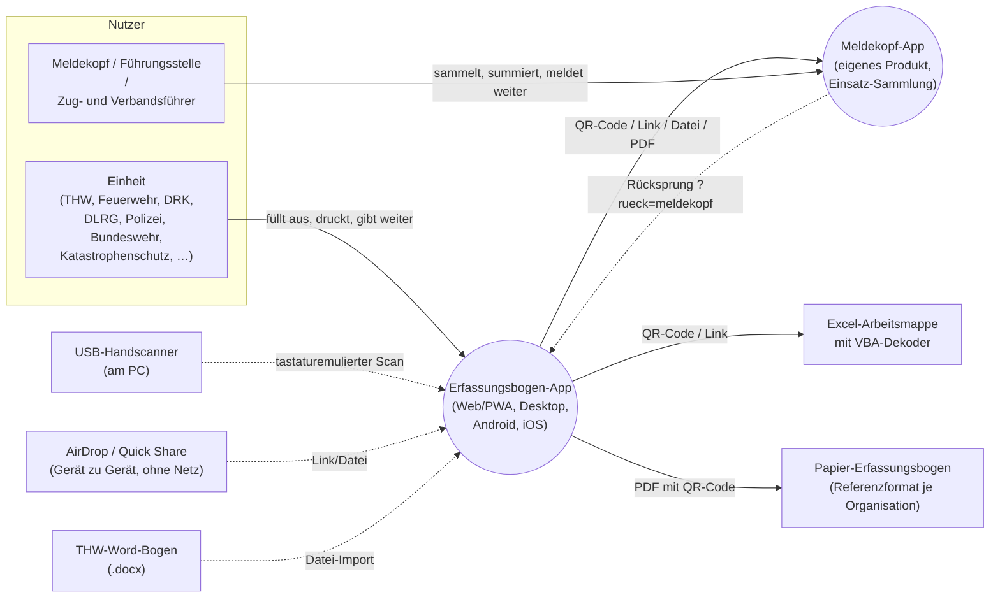

**Kommunikationspartner und Schnittstellen**

| Partner / Nachbarsystem | Art der Schnittstelle | Beschreibung |
| --- | --- | --- |
| Einheit (Erfasser) | Bedienoberfläche (Web/App) | Füllt den Assistenten aus (Einheit, Einsatz, Personal, Fahrzeuge, Sofortbedarf), druckt PDF, gibt den Bogen per QR/Link/Datei/AirDrop weiter. Liest einen fremden Bogen ein, um ihn zu ergänzen oder weiterzureichen (Gegenzeichnen, Kapitel 8.3). |
| Meldekopf-App (`meldekopf.erfassungsbogen.app`) | Nachbarsystem; QR-Code, Link, Datei, PDF im EEB-Format; ein Hyperlink in beide Richtungen, keine Netzverbindung der App | Führt die Einsatz-Sammlung. Die Startseite dieser App verweist dorthin (`src/app/meldekopf-weg.tsx`, `meldekopf-app.ts`). Im Übergabe-Dialog öffnet „An Meldekopf-App geben" die Meldekopf-App mit dem signierten Bogen im URL-Fragment (`meldekopfLink()`); das Fragment geht nicht an den Server. Umgekehrt öffnet die Meldekopf-App diese App mit `?rueck=meldekopf`, damit hier der vollständige Bogen einer nur schnell erfassten Einheit entsteht. Einsatz-Sammlungen, die aus der Zeit vor der Trennung noch unter `eeb.einsaetze.v1` auf einem Gerät liegen (Altbestand), nennt die Startseite mit Zahl; sie gehen als Datensicherung hinüber (die Meldekopf-App spielt sie ein) oder werden mit Rückfrage gelöscht (`meldekopf-altbestand.ts`). |
| S1-Control | Nachbarsystem; QR-Code, Link, Datei im EEB-Format | Liest Bögen und konsumiert denselben Kern (ADR-003). Kein Datenfluss zurück. |
| Papier-Erfassungsbogen der Organisation | Referenzformat (kein Datenfluss) | Das PDF folgt dem gewohnten Papierbogen, damit Ausdrucke in bestehende (nicht-digitale) Meldewege passen; beim THW im nachgemessenen Raster der Word-Vorlage `06-K_A_Erfassungsbogen.dotx` (Kapitel 5.2). |
| THW-Word-Bogen (`06-*_Erfassungsbogen.dotx`, ausgefüllt als `.docx`) | Datei-Import | „Aus Datei laden…" liest die Word-Formularfelder und bildet sie auf den Bogen ab (`src/app/word-bogen.ts`, Feldtabelle in `docs/thw-word-vorlagen.md`); was sich nicht zuordnen lässt, steht in „Sonstiges" und in der Quittung. |
| CSV- oder Excel-Liste des Personals | Datei-Import | „Personal einlesen…" liest eine Liste (CSV, `.xlsx`) in den Personalstamm des Geräts (`src/app/personalstamm-import.ts`); die App liefert dazu eine Mustervorlage. |
| USB-Handscanner | Tastatur-Emulation | Der Scanner „tippt" den dekodierten QR-Inhalt wie eine Tastatur ein; die App erkennt die Folge am Tempo (`src/app/handscanner.ts`, im Scanner-Fenster und auf der ganzen Seite außerhalb von Textfeldern, Abschluss mit Enter/Tab oder nach kurzer Stille) und entwirrt scancode-bedingte Tastaturbelegungsfehler (`src/app/tastaturbelegung.ts`). |
| AirDrop (Apple) / Quick Share (Android) | Betriebssystem-Nahfeldfreigabe | Reiner Transportkanal für den geteilten Link/die Datei; die App implementiert dafür nichts außer einem teilbaren Link. |
| Excel-Arbeitsmappe mit VBA-Dekoder (`vendor/eeb-format/ports/vba/`) | Fremdleser des QR-Formats (Handscanner/Link → Tabellenzeile) | Handgepflegte Portierung des Lesewegs in VBA (Base41/Base64url, Deflate, Binärstrom, `EEBS.`-Serien), Schema 2 bis 13; Signaturen werden übersprungen und nicht geprüft. Lebt im Format-Repo unter `ports/`; dessen CI hält sie gegen `SCHEMA_VERSION`, und das Vokabular-Modul wird hier per `npm run vokabular:excel-vba` aus `bos-vokabulare` erzeugt (`ci.yml` prüft den Stand). Sie ist der Weg einer Führungsstelle zu ihrer eigenen Tabelle; einen XLSX-Export hat die App nicht (ADR-001). |
| THW-Ortsverbandsverzeichnis | Eingebettete Referenzdaten (kein Live-Zugriff) | ~700 THW-Ortsverbände mit Nummer/Name/Kontakten sind im Bundle enthalten; ein QR kann statt der ausgeschriebenen Hierarchie nur die Ortsverbandsnummer tragen (`standortRef`). |

### 3.2 Technischer Kontext

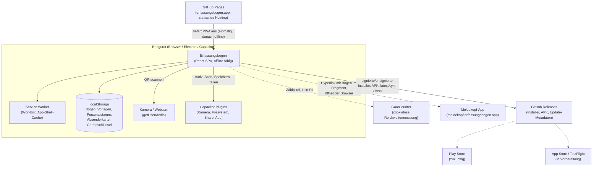

| System | Richtung | Zweck | Protokoll/Format |
| --- | --- | --- | --- |
| GitHub Pages (erfassungsbogen.app) | eingehend (einmaliger Ladevorgang) | Statisches Hosting der PWA; nach dem ersten Laden läuft die App vollständig offline (Service Worker). Übungsbögen der Klasse „nur auf Abruf" und der Erklärfilm kommen beim ersten Öffnen von derselben Herkunft (Kapitel 6.4, 7.4). | HTTPS, statische Dateien aus `dist/` |
| GoatCounter | ausgehend | Cookielose, datensparsame Reichweitenmessung; einziger in der CSP erlaubter externer Host | HTTPS-Zählpixel (`img-src`/`connect-src` in der CSP) |
| Meldekopf-App | ausgehend, nur als Navigation | Link der Startseite und „An Meldekopf-App geben"; die App ruft dort nichts ab, der Host steht nicht in `connect-src` | `https://meldekopf.erfassungsbogen.app/#…`, Bogen im Fragment |
| GitHub Releases | ein-/ausgehend | Verteilt Desktop-/Android-Installer; `electron-updater` prüft im Hintergrund auf neue Versionen | `latest*.yml`-Metadaten + Binärartefakte, generischer electron-updater-Provider |
| Google Play Store / Apple App Store | ausgehend (geplant) | Zukünftiger Vertriebsweg für Android/iOS; laut `README.md` noch nicht produktiv | – |
| Capacitor-Plugin-Schicht | intern (nativ) | Kapselt native Fähigkeiten (Kamera-Barcode-Scan, Dateisystem, Teilen, App-Lifecycle/Deep-Links) einheitlich für Android/iOS | Capacitor-Bridge (JS ↔ nativer Code) |

Es gibt **kein Backend, keine Datenbank und keine Nutzerkonten** – eine
bewusste, mehrfach dokumentierte Produktentscheidung („Kein Server, keine
Anmeldung, keine Cloud", `PRODUCT.md`).

---

## 4. Lösungsstrategie

### 4.1 Reines Client-System statt Server-Architektur

Alle fachlichen Prozesse (Bogen ausfüllen, PDF erzeugen, QR kodieren/dekodieren,
Datei-Import, CSV-Export) laufen vollständig im Client. Es existiert
kein Application- oder Datenbank-Server. Die einzige Infrastruktur ist
statisches Hosting (GitHub Pages) für den initialen Ladevorgang und GitHub
Releases als Downloadquelle für native Installer.

### 4.2 Eine Web-Codebasis, drei native Hüllen

- **Browser/PWA** – direkt unter erfassungsbogen.app, Service Worker für
  Offline-Start.
- **Electron** (`electron/main.js`) – lädt dasselbe gebaute `dist/` als
  Datei-URL, kein Node-Zugriff im Renderer (`contextIsolation: true`,
  `nodeIntegration: false`, `sandbox: true`); native Fähigkeiten werden gezielt
  und minimal freigeschaltet.
- **Capacitor** (Android, iOS in Vorbereitung) – dieselbe Web-App in einer
  WebView; native Fähigkeiten über Capacitor-Plugins (`src/app/nativ.ts`).

Weichenstellungen (`istNativ()`, `imWebBrowser()`) entscheiden zur Laufzeit, ob
der Service Worker registriert wird, ob Systemdialoge vermieden werden müssen
und ob Web-Download- oder natives Share-Sheet-Verhalten greift.

### 4.3 UI-freier Kern als geteiltes, versioniertes Fundament

Datenmodell, Codec, Signatur, Meldekopf-Logik, Vokabulare und taktische
Zeichen liegen in vier eigenständigen Bibliotheken als Git-Submodule unter
`vendor/`. Grund ist das zweite Produkt S1-Control, das denselben Codec und
dieselbe Meldekopf-Logik benötigt (ADR-003). Zwei CI-Prüfungen (`kern-kopien`,
`bundle-budget`) verhindern Architekturverfall.

### 4.4 Datensparsamkeit als Architekturtreiber

Weil der einzige Offline-Transportweg ein QR-Code ist, bestimmt dessen begrenzte
Kapazität weite Teile der Datenmodellierung: kontrolliertes Vokabular statt
Freitext, organisationsspezifische 1-Byte-Codes, Varint-Kodierung,
Deflate-Kompression und eine alphanumerisch-optimierte Base41-Transportkodierung
(Kapitel 8.5, `docs/datenmodell.md`).

### 4.5 Schema-Evolution statt Breaking Changes

Das Datenformat steht bei Schema-Version 13 (von v1, THW-spezifisch, bis v13,
abweichende Farbe des taktischen Zeichens je Fahrzeug; Kapitel 8.4). Jede
App-Version kann Schema `2..SCHEMA_VERSION` lesen und migriert beim Laden
automatisch; beim Schreiben wird stets die kleinste tragende Version gewählt
(`transportSchemaVersion`). Wo eine ungenaue Anzeige in älteren Lesern weniger
schadet als ein abgelehnter Bogen, belegt ein neues Merkmal ein freies Bit ohne
höhere Version (Einzelperson) oder bleibt eine Freitext-Konvention.

### 4.6 Sicherheitsmodell ohne zentrale Instanz

Dezentrales, TOFU-artiges Vertrauensmodell: jedes Gerät erzeugt lokal ein
Ed25519-Schlüsselpaar; signierte QR-Codes belegen, dass ein Datensatz unverändert
von genau diesem Schlüssel stammt – nicht, wem der Schlüssel gehört. Eine
Signaturkette („Gegenzeichnen") macht den Meldeweg über mehrere Stellen
nachvollziehbar.

### 4.7 Testautomatisierung entlang der Risikoverteilung

Plattformneutrale Logik (Codec, Datenmodell, Migration) wird mit schnellen
Vitest-Unit-Tests abgesichert, inklusive eingefrorener Golden-Fixtures für alte
Schema-Versionen. Beobachtbares Nutzerverhalten wird mit Cucumber/Playwright
gegen den produktiven Build getestet. Native Gerätetests sind als teuerste Stufe
bewusst zurückgestellt (`docs/tests.md`, Ausbaustufe 3).

### 4.8 Generierte statt handgepflegte Artefakte

`sitemap.xml` (Datum aus der Git-Historie), die Kopfnavigation der 36
statischen Seiten (aus `src/app/kopfnav.ts`), die Content-Security-Policy sowie
das Inline-Font-CSS entstehen im Build. Leitmotiv laut Code-Kommentar: „von Hand
gepflegt wäre es nach dem nächsten Release falsch, und ein falsches Datum ist
schlechter als keines."

---

## 5. Bausteinsicht

### 5.1 Whitebox Gesamtsystem (Level 1)

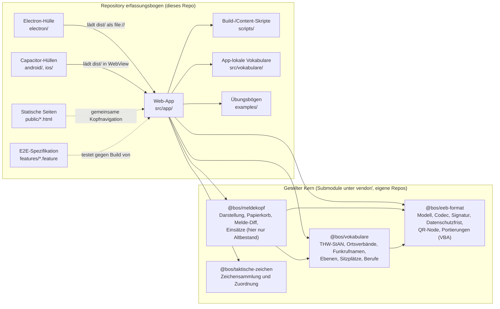

| Baustein | Verantwortung |
| --- | --- |
| Web-App (`src/app/`) | React-Oberfläche, Assistent, Vorlagen und Personalstamm, Empfang und Übergabe eines Bogens, PDF- und CSV-Ausgabe, Plattform-Anpassung, lokale Persistenz. |
| Statische Seiten (`public/*.html`) | 36 SEO-/Informationsseiten je Organisation (THW, Feuerwehr, DRK, …), Anleitung, Datenschutz, Impressum – teilen sich Kopfnavigation und Design-Token mit der App, laufen aber außerhalb des React-Bundles. Sie übernehmen den Anzeigemodus der App (Dunkel/Feld/Nacht, ohne gespeicherte Wahl die Systemeinstellung) über einen kleinen Inline-Block, den `scripts/content-stil.mts` schreibt; er liest nur `eeb.anzeigemodus.v1` und setzt eine Klasse auf `<html>`. |
| Electron-Hülle (`electron/main.js`) | Desktop-Fenster, Auto-Update (`electron-updater`), eingeschränkte Berechtigungsvergabe, externe Links im Systembrowser öffnen. |
| Capacitor-Hüllen (`android/`, `ios/`) | Native Projekte (Gradle/Xcode), binden Capacitor-Plugins (Kamera-Barcode-Scanner, Filesystem, Share, App) ein. |
| Build-/Content-Skripte (`scripts/`) | Vite-Plugin-Hilfsfunktionen, Übungsbogen-Generatoren je Bundesland/Organisation, Blanko-Vordruck, Icon-/Screenshot-Rendering, Sitemap, Kopfnavigation, Aufteilung des Offline-Vorrats, Bundle-Budget-Prüfung, Kern-Kopien-Prüfung, SBOM, VBA-Vokabular für die Format-Portierung. |
| E2E-Spezifikation (`features/`) | Gherkin-Szenarien auf Deutsch als ausführbare Anforderungsdokumentation und Regressionsschutz. |
| App-lokale Vokabulare (`src/vokabulare/`) | Inhalte, die laut `docs/entwicklung.md` bewusst nicht in den Kern gewandert sind: Landesvorlagen (`import.meta.glob`, eine Vite-Eigenschaft) und die Großstadtregelung der Funkrufnamen (`thw-funkrufname-ort.ts`). |
| Übungsbögen (`examples/`) | Rund 5 550 Bögen fiktiver Einheiten als JSON, von den Generatorskripten erzeugt; sie speisen den Übungsbögen-Dialog und die Landesvorlagen in Schritt 1 (Kapitel 6.4). |
| `@bos/eeb-format` | Datenmodell (`model.ts`, 564 Zeilen), Binär-/QR-Codec (`codec.ts`, 1089 Zeilen — größtes Modul des Formats), Ed25519-Signatur (`signatur.ts`, 340 Zeilen), Datenschutzfrist (`datenschutzfrist.ts`), QR-Erzeugung außerhalb des Browsers (`qr-node.ts`), handgepflegte Portierungen unter `ports/`. |
| `@bos/meldekopf` | Reine Logik der Einsatz-Sammlung (`einsaetze.ts`, 854 Zeilen), Aufteilen/Zusammenführen, Melde-Diff (`meldung-diff.ts`, 357 Zeilen), Papierkorb, Text-Darstellung – bekommt die Speicher-Ablage von außen hineingereicht. Diese App nutzt Darstellung, Papierkorb und Diff; die Sammlung selbst liest sie nur noch für den Altbestand (Kapitel 5.4). |
| `@bos/vokabulare` | Große, organisationsspezifische Nachschlagetabellen: `berufe.ts` (3531 Zeilen), `thw-ov-regionalstruktur.ts` (784) und `thw-ov.ts` (695), `thw.ts`, `thw-funkrufnamen.ts`, `ebenen.ts`, `sitzplaetze.ts`, `dlrg-qualifikationen.ts`. Bewusst modulgenau importierbar. |
| `@bos/taktische-zeichen` | Zuordnungslogik (`zeichen.ts`, 591 Zeilen, dreistufige Auflösung) auf einer wöchentlich automatisch aktualisierten, extern bezogenen Zeichensammlung (`symbole.ts`, 765 Zeilen); kennt den Erfassungsbogen selbst nicht. |

Alle vier Repositories tragen ein nahezu identisches, im jeweiligen `README.md`
dokumentiertes Regelwerk **„Aufnahmeregeln (ADR-003)"** mit sechs Regeln sowie
einen dokumentierten **Rückweg**: Blockiert der geteilte Kern zweimal in drei
Monaten ein Release des Schwesterprodukts, wird der jeweilige Stand als Kopie
übernommen und beide Seiten getrennt weitergepflegt (Kapitel 9).

### 5.2 Whitebox „Web-App" (Level 2)

Einstieg ist `src/app/main.tsx` (Plattform-Setup, Speicher verdrahten,
Wurzelknoten mit Fehlerfänger), die eigentliche Anwendung steht in
`src/app/app.tsx` (State-Haltung über React-`useState`, Hash-Fragment-Routing für
QR-/Link-Einstiege, kein Router-Framework).

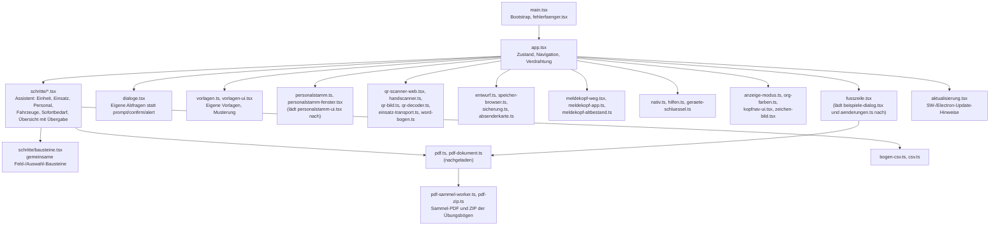

| Untermodul | Aufgabe |
| --- | --- |
| `schritte/` | Ein Schritt des Erfassungs-Assistenten je Datei (`einheit.tsx`, `einsatz.tsx`, `personal.tsx`, `fahrzeuge.tsx`, `sofortbedarf.tsx`, `uebersicht.tsx`); gemeinsame UI-Bausteine in `bausteine.tsx`, die Mehrzeilen-Namenseingabe in `namen-dialog.tsx` (nachgeladen), Telefonfelder in `telefon-feld.tsx`. `uebersicht.tsx` trägt auch den Übergabe-Dialog: QR-Code im Vollbild, PDF, Nahbereich, Link, CSV und „An Meldekopf-App geben". |
| `dialoge.tsx` | Ersatz für Systemdialoge: `frageText`/`frageFelder` (statt `prompt`), `frageJaNein` (statt `confirm`), `frageWahl` (bis zu drei Wege im festen Fuß), `zeigeHinweis` (statt `alert`); gezeichnet von einer einmal eingehängten `<Dialogschicht />`. Den Verlaufseintrag je offenem `<dialog>` und die Zurück-Geste führt `modal-overlay.ts`. |
| `vorlagen.ts` / `vorlagen-ui.tsx` / `musterung-stand.ts` | Gespeicherte Vorlagen mit Papierkorb, „Vorlage bearbeiten" (der Bogen läuft durch den Assistenten und wird mit „Vorlage aktualisieren" in dieselbe Vorlage zurückgeschrieben, `vorlageAktualisieren`; der Entwurf trägt dafür `Entwurf.vorlageId`), „Vorlage teilen" (QR/Link mit Marker `V.`, Datei `eeb-vorlage`) und die Musterung „Einsatz vorbereiten". |
| `personalstamm.ts` / `personalstamm-fenster.tsx` (Startbündel), `personalstamm-import.ts` / `personalstamm-auswahl.ts` / `personalstamm-ui.tsx` (nachgeladen) | Personalstamm des Geräts unter `eeb.personalstamm.v1`: Typen, Ablage, Alter und der Abschnitt der Startseite im Startbündel; CSV- und `.xlsx`-Leser mit Spaltenzuordnung, Abgleich „neu / geändert / entfällt" und Mustervorlage, Suche und Filter, die Fenster „Personal einlesen…" und „Wer ist dabei?" nachgeladen. Der `.xlsx`-Leser kommt ohne eigene Abhängigkeit aus (`zipEintrag` aus `word-bogen.ts`, pako, `DOMParser`); die Mustervorlage schreibt `zip-schreiben.ts` ohne Kompression. Der Stamm speichert Text statt Vokabular-Codes; erst beim Auswählen wird die Funktion ins Vokabular der Organisation des Bogens übersetzt. |
| `qr-scanner-web.tsx` + `qr-bild.ts` / `qr-decoder.ts` / `kamera.ts` / `teil-quittung.tsx` | Web-QR-Scan per `getUserMedia`, Decodierung mit ZXing (WebAssembly) und jsQR als Rückfallebene, Kamerawahl, Einzelbild-Decodierung (`qrAusBild`, `qrAlleAusBild` liest alle Codes eines Bildes), Kästchenzeile für die Teile eines mehrteiligen Bogens. |
| `handscanner.ts` / `tastaturbelegung.ts` | Tastatur-Wedge-Erkennung am Tempo (Abschluss mit Enter/Tab oder nach kurzer Stille), genutzt vom Scanner-Fenster und von `App` als seitenweiter Lauscher außerhalb von Textfeldern; Entwirren von Tastaturbelegungsfehlern. |
| `pdf-dokument.ts` (rund 2 350 Zeilen, größte Nicht-UI-Datei) | Baut die pdfmake-Dokumentdefinition des Bogens im nachgemessenen Raster der THWin-Vorlage `06-K_A_Erfassungsbogen.dotx` (Konstanten `RASTER`, `BOGEN_RAENDER`, `ZEILE_HOCH`, `ZEILE_PERSONAL`: Rahmen 474,9 pt ab x = 74,4 pt, Linien 0,5 pt, 10 pt Schrift, Mindesthöhen der Vorlage). Der Titelbalken ist dreigeteilt: Kurzzeichen, Titel in der Kennfarbe und beim THW die Wortbildmarke der Vorlage (`pdf-logo-thw.ts`), bei ASB, Bundespolizei, Bundeswehr, DLRG, DRK, JUH und MHD deren Logo als Vektorgrafik (`pdf-logos.ts`), sonst der Name der Organisation. Der Sofortbedarf steht wie in der Vorlage direkt unter den Fahrzeugen und nennt beim ausgefüllten Bogen nur angeforderte Posten (`sofortbedarfZellen`); Sitzplätze ohne eigene Angabe stehen als Richtwert des Typs (`sitzplatzZeile`), eine abweichende Zeichenfarbe als „Zeichen: …" darunter. Die Personaltabelle ist dreispaltig, Erreichbarkeit und abweichende Dienststelle („OV: …") stehen klein hinter dem Namen. `einzelPdfDokument` misst mit einem Probesatz ohne Bilder (pdfmake `pageBreakBefore`), wo freie Nachtragszeilen keine Seite kosten (`einzelNachtragsPlatz`). Jede Bogenseite trägt eine Kopfzeile im Seitenrand (`bogenKopfzeile`), Fahrzeugblöcke sind unteilbar, alle gedruckten Texte laufen durch `winAnsiText` (Helvetica/WinAnsi, Test `pdf-winansi.test.ts`). `boegenSammelDokument` reiht mehrere Einzel-PDFs in einer Datei aneinander (Übungsbögen-Dialog), Bogenbeginn je Seite aus einem Probesatz (`bogenAufSeite`). Die Seitenzahlen prüft `pdf-seiten.test.ts` mit echtem Satz. |
| `pdf.ts` / `pdf-helvetica.ts` / `pdf-kaestchen.ts` / `pdf-sammel-worker.ts` / `pdf-zip.ts` | Erzeugen und Ausgeben: `pdfErzeugen`, `blankoPdfErzeugen`, `sammelPdfErzeugen`, `einzelPdfsAlsZip`. pdfmake läuft nur mit Helvetica; `pdf-helvetica.ts` bildet auch „Roboto" (Schrift in den SVG der taktischen Zeichen) auf Helvetica ab. Ankreuzkästchen schreibt die Dokumentdefinition als „[X]"/„[  ]", `kaestchenZeichnen` ersetzt sie unmittelbar vor jedem `createPdf` durch gezeichnete Quadrate (ebenso in `scripts/pdf-in-node.ts`). Sammel-PDF und ZIP setzt ein Web Worker (Kapitel 6.4). Die Bausteine werden erst beim Klick per `import()` geladen. |
| `blanko.ts` | Bogen, Zeilenzahl (4 Fahrzeug-, 25 Personal-, 6 Qualifikationszeilen, zwei Seiten) und Metadaten des Blanko-Vordrucks; Quelle für die ausgelieferte Datei und für den Knopf „Blanko-Vordruck" (Kapitel 6.4). |
| `word-bogen.ts` / `word-bogen-fehler.ts` | Import ausgefüllter THW-Word-Bögen (`.docx`): eigener ZIP-Leser (nur „stored"/„deflate", kein ZIP64, verschlüsselt abgelehnt), entpackt nur `word/document.xml` über `inflateRawBegrenzt` (Deckel 8 MiB, Datei höchstens 25 MiB), liest die Word-Formularfelder (`w:ffData`) per `DOMParser` und bildet sie nach der Feldtabelle in `docs/thw-word-vorlagen.md` auf den `Erfassungsbogen` ab (Einheitstyp, Funktionen und Fahrzeugtypen über `@bos/vokabulare/thw`, Vorbelegungen der Vorlage gefiltert). Quittung „übernommen / unter Sonstiges / nicht übernommen"; Fehler als `WordBogenFehler`, von `datei-fehler.ts` durchgereicht. Nur nachgeladen. |
| `einsatz-transport.ts` / `pdf-bilder.ts` / `pdf-qr.ts` / `pdf-stroeme.ts` / `pdf-titel.ts` | Bögen aus einer PDF lesen: zuerst das eingebettete JSON (`boegenAusPdfBytes`, auch aus einer Sammel-PDF der Meldekopf-App), sonst als Rückfallebene die PDF-Bild-Objekte roh als Pixel lesen und den gedruckten QR-Code decodieren – bewusst ohne vollständigen PDF-Renderer (ADR-006). `pdf-titel.ts` erkennt Blanko und Lageblatt am Titel. |
| `bogen-csv.ts` / `csv.ts` | Datenexport eines Bogens als CSV im Langformat mit Satzart-Spalte (`bogenCsvInhalt`); gemeinsame CSV-Formatgrundlagen (Semikolon, UTF-8-BOM, Dezimalkomma). Neue Spalten werden hinten angefügt („Uhrzeit von/bis", „Zeichenfarbe"). |
| `entwurf.ts` / `uebergabe-stand.ts` / `fenster-abgleich.tsx` / `fenster-unterschied.ts` | Der eine Arbeitsbogen: Entwurfswiederherstellung, Rückholplatz, beschädigter Entwurf, Stand der letzten Übergabe (Weg `qr`, `pdf`, `link`, `kopiert`, `nah`, `meldekopf`) und der Abgleich zwischen zwei Fenstern desselben Geräts (Kapitel 8.2). |
| `speicher-browser.ts` / `speicher-schonend.ts` / `uhr-korrektur.ts` / `aufraeum-hinweis.ts` / `einsaetze-lesen.ts` / `unlesbar.ts` | Anbindung des Kerns an `localStorage` in Hüllen (Kapitel 8.2): kein Schreiben unveränderten Textes, Lesen scheitert nicht an einem gesperrten Speicher, geprüfte Uhr für die Fristen, Beiseitelegen unlesbarer Texte. Über diese Schicht liest die App den Altbestand an Sammlungen. |
| `meldekopf-weg.tsx` / `meldekopf-app.ts` / `meldekopf-altbestand.ts` | Abschnitt „Bögen sammeln (Meldekopf)" der Startseite mit Link zur Meldekopf-App, Adresse und Rückweg (`meldekopfLink`, `rueckMarkeUebernehmen`, `kamVomMeldekopf`), Zählen, Sichern und Löschen des Altbestands (`SAMMLUNGS_SCHLUESSEL`). |
| `sicherung.ts` / `absenderkarte.ts` / `geraete-schluessel.ts` | Datensicherung aller `eeb.`-Einträge als Datei, „Alle Daten löschen", freiwillige Absenderkarte, Erzeugung und Verwaltung des geräteeigenen Ed25519-Schlüssels. |
| `nativ.ts` / `hilfen.ts` | Abstraktion nativer Fähigkeiten über Capacitor; Kodieren, Signieren und Laden (`bogenLaden`, `migriereBogen`, `browserKompressor`, `QrSatz` mit `teileOhneGegenzeichnung`, `vorlageTransportErzeugen`), Anzeigehelfer (`einheitAnzeigename` gibt jeden Namensteil nur einmal aus, `einzelpersonAbgleich`, `dateinameSicher`). |
| `anzeige-modus.ts` / `org-farben.ts` | Dunkel-/Feld-/Nacht-Modus als Design-Token-Umschaltung; organisationsspezifische Akzentfarben, dazu je Kennfarbe die auf 4,5:1 gerechneten Kopf-Töne, im Dunkel-Modus der abgedunkelte Kopfbalken (`kopfDunkel()`), im Feld-Modus die auf 7:1 abgedunkelte Kennfarbe (`kopfFeld()`, die Statusleiste folgt). Auf Papier gilt für das THW das Vorlagen-Blau #003399 (`orgFarbePapier`), die Oberfläche bleibt bei #20214f. |
| `zeichen-bild.tsx` / `taktische-zeichen-bogen.ts` | `EinheitZeichen` und `FahrzeugZeichen` laden die Zeichensammlung (`symbole.ts`) als eigenen Chunk nach; `taktische-zeichen-bogen.ts` löst das Zeichen aus dem konkreten Bogen auf, einschließlich der Zeichenfarbe. |
| `fusszeile.tsx` / `beispiele-dialog.tsx` / `beispiele-thw-ov.ts` / `aenderungen.ts` | Fußzeile mit Datensicherung, „Alle Daten löschen", „Geräteschlüssel neu erzeugen", Blanko-Vordruck und Version. Sie lädt den Übungsbögen-Dialog selbst nach (`import()` mit Fehlerfang statt `React.lazy`, damit ein Fehlschlag ohne Netz nicht die ganze App in den Fehlerfänger reißt) und beim Öffnen von „Was ist neu" den Änderungsverlauf (`aenderungen.ts`: ein Eintrag je Tag, je Monat ein Satz in `MONATE`, monatsweise blätterbar; eigener Chunk im Precache). |
| `zeitraum-eingabe.ts` / `telefon-eingabe.ts` / `email-pruefung.ts` / `zahl-eingabe.ts` / `schreibweise.ts` / `typografie.ts` | Eingabehilfen: Uhrzeit zum Zeitraum (Vorgabe 08:00 und 18:00, `einsatzVorgabe`; Konvention „Zeitraum nicht angegeben", `zeitraumLeer`), Telefonnummern (führendes „+", zweite Nummer abtrennen), E-Mail-Prüfung, Zahlen mit Einheit und Obergrenzen, Suchabgleich von Schreibweisen (ß/ss, ä/ae), Anführungszeichen. |
| `tipp-schutz.ts` | Fingerstellen-Sperre nach Handlungen, die unter dem Finger etwas austauschen (mehrere Stellen zugleich, nach bestätigter zerstörender Rückfrage verlängernd bis 4 s); „Abbrechen", „Rückgängig", „Zurück", „Schließen" und „✕" sind nie gesperrt (`istSichereGegenhandlung`); ein verworfener Tipp zeigt „Einen Moment …" und einen Rahmen am Knopf; Mindestanzeigedauer der QR-Teile im Vollbild. |
| `schrift-stufe.ts` | Setzt die Klasse `schrift-gross` auf `<html>`, solange die tatsächliche Grundschrift mindestens 22 px misst (Systemschrift ab etwa 137 %); das Stylesheet verdichtet Kopf und Formular bei niedrigem Fenster. |
| `tastatur.ts` | Setzt die Klasse `tastatur-offen` auf `<html>`, solange ein Texteingabefeld den Fokus hat und die sichtbare Höhe deutlich unter der gewohnten liegt (Bildschirmtastatur); das Stylesheet blendet dann die feste Fußleiste aus, damit sie nicht über der Vorschlagsliste liegt. Reine Darstellung: liest nur Fenstergröße und Fokus, speichert nichts, spricht kein Netz an. |
| `aktualisierung.tsx` | Update-Hinweise: Service-Worker-Banner im Web („Neu laden" lädt nach 1,5 s selbst neu, falls der Service Worker nichts auslöst, `neuLadenMitRueckfall`), Electron-Auto-Update-Status im Desktop. |

**Reste der Einsatz-Sammlung im Code.** Eine Oberfläche für die Sammlung hat die
App nicht, einige Module darunter schon. `eintrag-zeiten.ts`, `fassung-vorrang.ts`,
`export-stand.ts`, `einsatz-abgleich.ts`, `einheiten-tabelle.ts`, `auswertung.ts`,
`entfernte-meldungen.ts`, `lage-angaben.ts`, `lagemonitor-beginn.ts` und
`lagemonitor-speicher.ts` liegen weiter in `src/app/`. In Gebrauch sind daraus
Einzelteile: Speicherbelegung und Fehlerarten des Speichers
(`speicherBelegung`, `speicherFehlerArt`, `speicherGesperrt` in
`eintrag-zeiten.ts`), der Aufräum-Hinweis für ruhende Sammlungen des Altbestands
(`aufraeum-hinweis.ts` über `geltendeJeEinheit`), `betriebsstoffText` in
`auswertung.ts` für das PDF, `bedarfMarken` in `einheiten-tabelle.ts` für die
Vorlagenkarten. Der Rest ist ohne Aufrufer in der Oberfläche (Kapitel 11.3).

### 5.3 Whitebox „@bos/eeb-format" (Level 2)

`@bos/eeb-format` ist mit 4555 Zeilen unter `src/` (Produktivcode + Tests) das am
striktesten abgeschottete der vier Kern-Module. Es hat zwei Einstiegspunkte:

```ts
import { SCHEMA_VERSION, encodePayloadUrl } from "@bos/eeb-format";      // plattformneutral
import { bogenZuQrSvg, nodeKompressor } from "@bos/eeb-format/node";     // nur Node/Electron
```

| Modul | Verantwortung |
| --- | --- |
| `model.ts` (564 Zeilen) | Typdefinitionen (`Erfassungsbogen`, `Einheit`, `Person`, `Fahrzeug`, `Sofortbedarf`, `HierarchieEbene`, …), Enums (`OrganisationsTyp`, `StaerkeRolle`, `Fahrerlaubnis`, `Geschlecht`, `Ernaehrung`, `KontaktArt`, `Zeichenfarbe`, `PersonalErfassung`), abgeleitete Werte (`staerke()`, `unterbringungMWD()`, `verpflegung()`, `ansprechpartner()`, `istEinzelperson()`), Datums-/Zeitkonvertierung (`EebDatum`, `EebZeitpunkt`, Referenzepoche 2020-01-01), `SCHEMA_VERSION = 13`, `transportSchemaVersion()`, `migriereBogen()`. Importiert laut Kopfkommentar bewusst nichts. |
| `codec.ts` (1089 Zeilen) | Binärkodierung/-dekodierung, Base41-Transportkodierung, QR-Payload-Aufbau (`EEB2`/`EEB2C`), Segmentierung großer Bögen, `MAX_STUFEN = 32`. Die Kompression wird als `Kompressor`-Funktion hineingereicht (Browser: pako, Node: `node:zlib`). |
| `signatur.ts` (340 Zeilen) | Ed25519-Signatur/-Verifikation, Signaturkette („Gegenzeichnen", `gegengezeichnetePayloadBytes`), Container-Format `EEB2C`, Absenderkarten-Kodierung. |
| `datenschutzfrist.ts` (163 Zeilen) | Datenschutzfrist: Ende 90 Tage nach `stand`, Übungen ausgenommen (`datenschutzfristEnde`, `datenschutzfristAbgelaufen`, `tageBisAnonymisierung`), Anonymisierung eines Bogens (`bogenAnonymisiert`) und Plausibilitätsprüfung der Geräteuhr gegen Sprünge nach vorn (`uhrPruefen`). Baut nur auf `model` auf; kein Schemafeld. |
| `qr-node.ts` (50 Zeilen) | QR-Erzeugung außerhalb des Browsers (SVG/PNG), z. B. für die Übungsbogen-Generatorskripte. Einziges Modul, das `node:zlib`, `qrcode` und `Buffer` benutzen darf. |
| `index.ts` (91 Zeilen) | Öffentliche Fassade: reexportiert `model`/`codec`/`signatur`/`datenschutzfrist` (nicht `qr-node`), definiert `kernVersion()` sowie eine handgeschriebene UTF-8-Kodierfunktion, die bewusst ohne `TextEncoder` auskommt. |
| `ports/` (außerhalb von `src/`) | Handgepflegte Leser des Formats in anderen Sprachen, derzeit `ports/vba/` für Excel (`m_digitalerEEB.bas`, `m_digitalerEEBParsing.bas`, `m_digitalerEEBVokabular.bas`, `PORT.json` mit Schema-Stand 13), dazu `ports/testvektoren/testvektoren.json`. Sie werden nicht generiert, mit einer Ausnahme: Das Vokabular-Modul erzeugt `npm run vokabular:excel-vba` in diesem Repository aus `bos-vokabulare`. Jede Formatänderung zieht die Portierungen im selben Arbeitsschritt nach (`CLAUDE.md`). |

Architektonische Besonderheiten, die die Trennung technisch erzwingen:

- `tsconfig.json` lässt `"DOM"` bewusst aus `lib` weg und setzt `"types": []` —
  schon `document`, `window` oder `Buffer` lässt die Typprüfung scheitern.
  `qr-node.ts` ist per eigenem `tsconfig.node.json` ausgenommen.
- `eslint.config.mjs` verbietet per `no-restricted-imports` alle `node:`-Module,
  Electron, Capacitor, React und DOM-nahe Pakete außerhalb von `qr-node.ts`
  sowie jeden Rückimport aus `@s1/*` oder der Erfassungsbogen-App.
- `vitest.config.ts` fährt dieselben Testdateien in zwei Projekten — einmal
  unter `node`, einmal unter `jsdom` — als laufender Beweis der
  Plattformneutralität.
- Konsumiert wird das gebaute `dist/` (`tsc -p tsconfig.build.json`), nicht
  `src/` direkt: ein direkter Export auf `./src/index.ts` funktioniert nur,
  solange der `file:`-Pfad ein Symlink ist, und scheitert sonst mit
  `ERR_UNSUPPORTED_NODE_MODULES_TYPE_STRIPPING`. Der Erfassungsbogen umgeht das,
  indem Vite `@bos/*` per Alias direkt auf `vendor/*/src/*.ts` abbildet.
- Es gibt bewusst **kein** `prepare`-Skript (siehe ADR-003a).

### 5.4 Whitebox „@bos/meldekopf" (Level 2)

`@bos/meldekopf` (3681 Zeilen unter `src/`) implementiert die Einsatz-Sammlung als
reine, speicherunabhängige Logik. Hauptnutzer sind die Meldekopf-App und
S1-Control; diese App nutzt einen Teil davon.

| Modul | Verantwortung | Nutzung in dieser App |
| --- | --- | --- |
| `einsaetze.ts` (854 Zeilen) | Die Sammlung selbst: Einsatz anlegen (`einsatzAnlegen`), Revisionen je Einheit stapeln, Zuordnung per inhaltsbasiertem Fingerabdruck/Dedupe, Idempotenz über Inhalts-Hash. Drei Fristen in `alleEinsaetzeLaden`: Papierkorb (30 Tage), ruhende Sammlung (90 Tage ohne Änderung, `AUFRAEUM_FRIST_MS`) und Datenschutzfrist je Meldung (`fristBereinigt`: nach 90 Tage altem Stand anonymisiert, ohne Rohpayload und Signaturnachweis). | Lesen des Altbestands über `einsaetze-lesen.ts`, damit Aufräumfrist und Datenschutzfrist an Sammlungen weiter greifen, die die App nicht mehr zeigt. `einheitSchluessel` und `bogenInhaltsId` dienen dem Übergabe-Stand des eigenen Bogens (`uebergabe-stand.ts`). |
| `aufteilen.ts` / `zusammenfuehren.ts` | Eine Meldung in zwei zählende Einheiten trennen (ohne Stärke zu verlieren) bzw. die Gegenrichtung. | keine |
| `meldung-diff.ts` (357 Zeilen) | Was sich zwischen zwei Fassungen einer Meldung geändert hat; meldet auch eine geänderte Zeichenfarbe. | Unterschied zweier Fassungen desselben Bogens in zwei Fenstern (`diff-lage.ts`, `fenster-unterschied.ts`). |
| `papierkorb.ts` | Wiederherstellbarkeit für 30 Tage (`PAPIERKORB_FRIST_MS`), danach endgültiges Löschen. | Papierkorb der Vorlagen (`vorlagen.ts`, `papierkorb-frist.ts`). |
| `darstellung.ts` | Bogeninhalte als Text, wie sie auf dem Papierbogen stehen — plattformneutrale Vorstufe für PDF/CSV-Ausgabe (`kontaktText` mit `Funk: …`, `zeichenfarbeText`, `einheitOrt`, `einzelpersonFunktion`). Stärke in der Schreibweise `F / U / M // G`. | Übersicht, PDF, CSV, taktische Zeichen. |

Die Ablage wird **hineingereicht, nicht selbst geholt** (Aufnahmeregel 2 aus
ADR-003):

```ts
import { speicherhuelleSetzen, datenschutzUhrSetzen } from "@bos/meldekopf/einsaetze";

speicherhuelleSetzen(huelle);                      // src/app/speicher-browser.ts, localStorage in drei Hüllen
datenschutzUhrSetzen(() => datenschutzZeitpunkt()); // geprüfte Uhr für die Datenschutzfrist
```

Ohne diesen Aufruf arbeitet die Sammlung speicherlos (Listen bleiben leer,
Schreibvorgänge verpuffen) — bewusst dasselbe Verhalten wie bei blockiertem
Browser-Speicher (Privatmodus), kein Absturz.

`@bos/eeb-format` und `@bos/vokabulare` sind `peerDependency`, nicht
`dependency`: läge das Format ein zweites Mal im Abhängigkeitsbaum, sähe
TypeScript zwei verschiedene Typen namens „Bogen" (das „Diamant-Problem" aus
ADR-003). Eine dokumentierte Ausnahme betrifft `src/plattform.d.ts`:
`crypto.randomUUID()` wird optional deklariert; fehlt es zur Laufzeit, fällt die
Sammlung auf Zeitstempel + Zufallszahl zurück.

### 5.5 Whitebox „@bos/vokabulare" (Level 2)

`@bos/vokabulare` (6865 Zeilen unter `src/`, der datenreichste Kern-Baustein)
liefert reine Nachschlagetabellen plus Zugriffsfunktionen, keine Geschäftslogik:

| Modul | Inhalt |
| --- | --- |
| `berufe.ts` (3531 Zeilen) | 3512 Berufsbezeichnungen der Bundesagentur für Arbeit. |
| `thw-ov-regionalstruktur.ts` (784) / `thw-ov.ts` (695) | THW-Ortsverbände, Geschäftsstellen, Landesverbände (Basis für `standortRef`). |
| `thw.ts` (311) | StAN-Vokabulare: Einheitstypen, Funktionen, Fahrzeugtypen, Funkruf-Kennwörter. Der Fachzug Logistik ist gegen die StAN 09-04 bis 09-07 (Stand 01.07.2026) geprüft: Einheitstypen 47–49 (Tr Log-M, Tr Log-VG, Tr Log-TL), Fahrzeugtypen 28 (LKW K Lkr), 29/30 (Auflieger Plane/Spriegel, Container), 56–59 (Anhänger) und 60–65 (Ladungsträger: Abrollbehälter, Wechselbrücke, Container 10/20 ft, Abrollbehälter Kraftstoff, Werkstattcontainer). |
| `thw-funkrufnamen.ts` (230) | Kennwörter und Teile des Funkrufnamens. |
| `thw-funktionen-ergaenzung.ts` (164) | Funktionen jenseits der StAN-Taschenkarte. |
| `thw-stan-personal.ts` (141) / `thw-stan-fahrzeuge.ts` (135) | Sollausstattung je Teileinheit; die Fachgruppe Logistik-Materialwirtschaft belegt die Fahrzeuge ihrer drei Trupps vor. |
| `sitzplaetze.ts` (125) | Sitzplätze je Fahrzeugtyp (Richtwert) und je Fahrzeug (`Fahrzeug.sitzplaetze` schlägt den Richtwert), Bilanz gegen die Stärke. |
| `dlrg-qualifikationen.ts` (112) | Ausbildungskennzahlen der DLRG. |
| `ebenen.ts` (73) | Hierarchie-Ebenen je Organisation (THW OV→RB→LV, FW Gemeinde→LK→Bezirk→Land, …). |

Bewusst **nicht** in diesem Baustein: `landesvorlagen.ts` (bleibt im
Erfassungsbogen, weil es `import.meta.glob` nutzt und die Übungsbögen
Produktinhalt statt Vokabular sind), `src/vokabulare/thw-funkrufname-ort.ts`
(die OV-Kennzahlen der Großstadtregelung; Kandidat für den Kern, sobald ein
zweites Produkt sie eigenständig braucht) sowie die Zeichen-Symboldaten.

Neue Codes ziehen das VBA-Vokabular der Format-Portierung nach
(`npm run vokabular:excel-vba`, in `ci.yml` mit `--pruefen` gegen den Stand
gehalten).

### 5.6 Whitebox „@bos/taktische-zeichen" (Level 2)

`@bos/taktische-zeichen` (1773 Zeilen unter `src/`, ohne den Ordnerkatalog) löst
taktische Zeichen nach DV 102 auf und kennt das Bogenmodell dabei nicht:

```ts
import { fahrzeugZeichenSvg, einheitZeichenSvg } from "@bos/taktische-zeichen";

fahrzeugZeichenSvg({ organisation: "thw", kurz: "GKW", name: "Gerätekraftwagen" });
```

Entgegengenommen werden nur Organisation (eigener Schlüssel: `thw`, `feuerwehr`,
`polizei`, `bundeswehr`, `hilfsorganisation`, `wasserrettung`, `sonstige`),
Kurzzeichen, Name, optional ein Vokabular-Code und optional eine abweichende
Grundfarbe (`farbe: "kommunal" | "grau"`, `#E26E0E` bzw. `#A6A6A6`) — kein
`Einheit`-, `Fahrzeug`- oder `OrganisationsTyp`-Typ. Das Auflösen aus einem
konkreten Erfassungsbogen übernimmt das Produkt
(`src/app/taktische-zeichen-bogen.ts`).

| Modul | Verantwortung |
| --- | --- |
| `zeichen.ts` (591 Zeilen) | Dreistufige Zuordnung: (1) bekannter Vokabular-Code (aktuell nur THW) → fest zugeordnetes Zeichen, (2) Namenssuche über Dateiname/Titel — zuerst organisationsintern, dann neutrale Grundzeichen, (3) kein Treffer → Grundzeichen (Kraftfahrzeug, Anhänger, Ladungsträger, Wechsellader, Wasserfahrzeug, Formation) in Organisationsfarbe mit Kurzzeichen beschriftet. Mit abweichender Farbe: das Kommunalzeichen der Sammlung, wo es eines gibt, sonst das umgefärbte Zeichen der Organisation. |
| `symbole.ts` (765 Zeilen, generiert) | Die eigentlichen SVG-Zeichen, bezogen aus der externen Sammlung `jonas-koeritz/Taktische-Zeichen` (CC BY 4.0), bearbeitet durch `scripts/holen.mts` im Submodul (entfernt eingebettete Schrift: ~26 KB → ~800 B je Datei, korrigiert `viewbox`→`viewBox`, setzt die Schriftfamilie „Roboto", die das Produkt beim PDF-Satz auf Helvetica abbildet). |
| `katalog.ts` (83 Zeilen) mit `katalog/` | Eigener Einstieg `@bos/taktische-zeichen/katalog`: der vollständige Katalog der Sammlung für Anwendungen, die Zeichen frei auswählen lassen. Bewusst nicht aus `index.ts` exportiert; der Erfassungsbogen nutzt ihn nicht und zieht ihn nicht ins Bundle. |

**Automatische Aktualisierung, aber ohne automatische Übernahme:** Ein eigener
Workflow (`.github/workflows/sammlung-aktualisieren.yml` im Submodul) prüft
wöchentlich montags 04:00 UTC, ob die externe Zeichensammlung ein neues Release
hat, erzeugt `symbole.ts` bei Bedarf neu und committet nach `main` — aber nur,
wenn Typecheck, Lint und die Zuordnungstabellen-Tests grün sind. Ob die Produkte
diesem Stand folgen, entscheidet der Submodul-Commit-Pin (ADR-003, Regel 6).

**Lizenzlage:** Code EUPL-1.2, Zeichen in `src/symbole.ts` CC BY 4.0
(© Jonas Köritz) — bei Weitergabe ist die Namensnennung mitzuführen. Das
Upstream-README merkt an, dass die Sammlung vor Februar 2021 anders lizenziert
war und ältere Angaben (z. B. „CC0") geprüft werden sollten.

### 5.7 Zuordnung Anforderung → Baustein

| Anforderung/Feature (Kapitel 1) | Primär verantwortliche Bausteine |
| --- | --- |
| Bogen ausfüllen (Assistent), Einzelperson, Schnellerfassung | `src/app/schritte/*`, `@bos/eeb-format/model`, `einzelpersonAbgleich` in `hilfen.ts` |
| Vorlagen & Musterung, Vorlage bearbeiten/teilen | `vorlagen.ts` (`vorlageAktualisieren`), `vorlagen-ui.tsx`, `musterung-stand.ts`, `vorlageBearbeiten` in `app.tsx`, `vorlageTransportErzeugen` in `hilfen.ts` |
| Personalstamm | `personalstamm.ts`, `personalstamm-import.ts`, `personalstamm-auswahl.ts`, `personalstamm-ui.tsx` |
| PDF drucken mit QR, Blanko-Vordruck | `pdf.ts`, `pdf-dokument.ts`, `blanko.ts`, `@bos/eeb-format/codec` |
| QR/Foto/USB-Scanner einlesen | `qr-scanner-web.tsx`, `qr-bild.ts`, `qr-decoder.ts`, `handscanner.ts`, `tastaturbelegung.ts` |
| Datei einlesen (JSON, PDF, Word) | `ladeDatei` in `app.tsx`, `einsatz-transport.ts`, `pdf-qr.ts`, `word-bogen.ts`, `datei-fehler.ts`, `bogen-pruefung.ts` |
| Übergabe an die Meldekopf-App, Altbestand | `schritte/uebersicht.tsx`, `meldekopf-app.ts`, `meldekopf-weg.tsx`, `meldekopf-altbestand.ts` |
| CSV-Export | `bogen-csv.ts`, `csv.ts` |
| Übungsbögen, Sammel-PDF und ZIP | `beispiele-dialog.tsx`, `beispiele-thw-ov.ts`, `pdf-sammel-worker.ts`, `pdf-zip.ts`, `zip-schreiben.ts` |
| Signatur/Herkunft | `@bos/eeb-format/signatur`, `absenderkarte.ts`, `geraete-schluessel.ts` |
| Datenschutzfrist und Geräteuhr | `@bos/eeb-format/datenschutzfrist`, `datenschutz-uhr.ts`, `uhr-korrektur.ts`, `uhr-folgen.ts`, `uhr-warnung.tsx` |
| Offline-Betrieb (PWA) | `vite.config.ts` (VitePWA), `scripts/precache-aufteilung.ts`, `offline-bereit.ts`, `offline-vorrat.ts`, `aktualisierung.tsx` |
| Desktop-Auto-Update | `electron/main.js`, `electron-updater` |

---

## 6. Laufzeitsicht

### 6.1 Bogen ausfüllen und als PDF/QR weitergeben

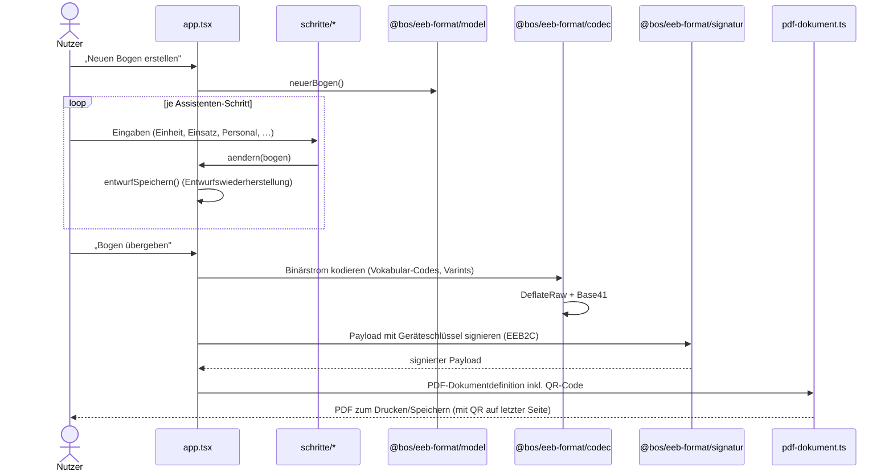

Zusätzlich verzweigt die App bei zu großem Bogen automatisch in die
Segmentierung (Kapitel 8.5): überschreitet der Payload das Zielbudget
(≤ QR-Version 18), erzeugt `codec.ts` mehrere `EEBS.`-QR-Codes statt eines
einzelnen `EEB2`/`EEB2C`-Codes.

### 6.2 QR-Code einlesen (inkl. Schema-Migration)

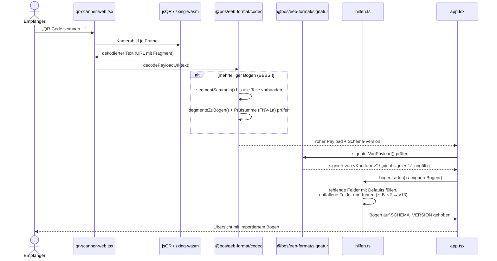

Wichtige Eigenschaften:

- Die Verifikation **blockiert den Import nie** – ein ungültig signierter oder
  unsignierter Bogen wird trotzdem geladen, nur der Vertrauenshinweis ändert
  sich (`docs/datenmodell.md`).
- Migration ist verlustfrei nach vorn: jede Version `2..SCHEMA_VERSION` wird
  akzeptiert; eingefrorene Payloads der Schemata 2 und 8 bis 12 dienen als
  Regressionstest (`vendor/eeb-format/src/codec.migration.test.ts`).
- Ein empfangener Bogen öffnet sich als Arbeitsbogen. Liegt schon ein
  angefangener Bogen auf dem Gerät, fragt `uebernimmBogen` zuerst und legt ihn
  dann auf den Rückholplatz (Kapitel 8.2); gleicht der eintreffende Bogen dem
  offenen (`bogenSchonOffen`), wird nichts ersetzt. Ein Bogen, dessen
  Datenschutzfrist abgelaufen ist, kommt anonymisiert an, und die Meldung sagt
  es.
- Die Teile eines mehrteiligen Bogens sammelt die App im Arbeitsspeicher; die
  Kästchenzeile (`teil-quittung.tsx`) zeigt, welcher Teil noch fehlt.
- Bei Scan über einen USB-Handscanner entfällt der Kamera-Schritt;
  `handscannerLauscher` in `src/app/handscanner.ts` sammelt die Tastenfolge im
  Scanner-Fenster und auch ohne offenes Fenster — ein Scan auf der Seite nimmt
  denselben Weg wie ein angetippter Bogen-Link. `entwirreScanText` in
  `src/app/tastaturbelegung.ts` korrigiert layoutbedingte Fehlinterpretationen,
  bevor `decodePayloadUrl` aufgerufen wird. Das Scanner-Fenster lässt sich auf
  „Handscanner statt Kamera" umstellen; der gewählte Weg liegt als `eeb-scanweg`
  im `localStorage` (wie die Kamerawahl `eeb-kamera`; keine Personendaten).

### 6.3 Bogen aus Datei öffnen und an die Meldekopf-App geben

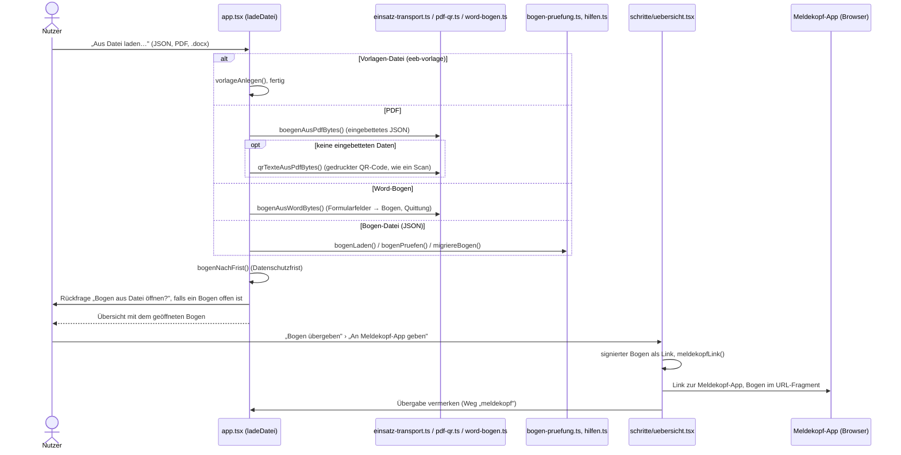

Eigenschaften dieses Wegs:

- **Erst lesen und prüfen, dann fragen und verdrängen.** Eine unbrauchbare Datei
  meldet sich ohne Rückfrage und lässt Arbeitsplatz und Rückholplatz unberührt;
  die Meldung nennt die Ursache auf Deutsch (`datei-fehler.ts`), nie den Text des
  Parsers.
- **PDF mit mehreren Bögen** (Sammel-PDF eines Meldekopfs): Geöffnet wird der
  erste Bogen, die Meldung nennt die Zahl und verweist für alle zusammen auf die
  Meldekopf-App.
- **Word-Bogen:** Eine `.docx` aus den THW-Vorlagen geht denselben Weg wie eine
  Bogen-Datei ohne Signatur. Vorher liest `word-bogen.ts` die Formularfelder und
  baut den Bogen; seine Quittung steht in der Rückmeldung.
- **Foto eines QR-Codes:** `qrAlleAusBild` liest je Bild alle QR-Codes (ZXing mit
  bis zu acht Symbolen; die jsQR-Rückfallebene liest nur einen) — das Foto einer
  Bogenseite mit zwei Teilen ergibt so einen Bogen.
- **Rückweg zur Meldekopf-App:** Der Link trägt denselben signierten Bogen wie
  „Link teilen", nur mit der Adresse der Meldekopf-App davor; das Fragment geht
  nicht an den Server. Hat die Meldekopf-App diese App mit `?rueck=meldekopf`
  geöffnet, merkt `rueckMarkeUebernehmen()` das vor dem Lesen des Fragments im
  `sessionStorage` (`eeb.rueck.meldekopf`, Inhalt „1") und nimmt den Parameter aus
  der Adresse; „An Meldekopf-App geben" steht dann als Hauptknopf vorn.
- **Weiterreichen:** Wird ein empfangener Bogen unverändert weitergegeben,
  zeichnet die App gegen, statt neu zu signieren. Kostet die Gegenzeichnung einen
  QR-Code mehr, nennt `QrSatz.teileOhneGegenzeichnung` (`hilfen.ts`) die Teilzahl
  des Absenders.

### 6.4 Offline-Start der Web-App (Service Worker)

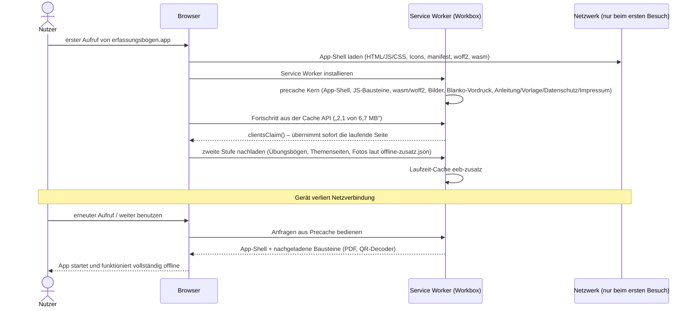

`clientsClaim: true` schließt eine dokumentierte Lücke: ohne diese Option bliebe
der erste Besuch am frisch installierten Service Worker vorbei am Netz hängen –
nachgeladene Bausteine (PDF-Satz, QR-Decoder, Landesvorlagen) kämen beim ersten
Klick aus dem Netz, und ein Funkloch direkt nach dem ersten Aufruf hätte „error
loading dynamically imported module" zur Folge (`docs/entwicklung.md`,
abgesichert durch das Szenario „Die PDF entsteht auch ohne Netz und ohne
Neuladen" in `features/uebergabe.feature`).

**Drei Klassen von Dateien.** `manifestTransforms`
(`scripts/precache-aufteilung.ts`) teilt das Workbox-Manifest:

| Klasse | Inhalt | Ablage |
| --- | --- | --- |
| Kern | App-Shell, alle JS-Bausteine einschließlich PDF, QR-Decoder, Landesvorlagen, Zeichensammlung und Änderungsverlauf, Schrift, Bilder, Blanko-Vordruck und die von der App verlinkten Seiten (`index.html`, `anleitung.html`, `vorlage.html`, `datenschutz.html`, `impressum.html`, `404.html`) | Workbox-Precache; Bedingung für „offline bereit" |
| Zusatzstufe (`istZusatz`) | Übungsbögen (ohne die der dritten Klasse), Themen- und Länderseiten, Fotos und Bildschirmfotos der Themenseiten (nur WebP) | Der Build schreibt die Liste nach `offline-zusatz.json`; die Startseite lädt sie nach der Aktivierung nach (`src/app/offline-vorrat.ts`), der Service Worker legt sie über Laufzeit-Routen in den Cache `eeb-zusatz` (höchstens 1500 Einträge; Übungsbögen `CacheFirst`, Seiten und Fotos `StaleWhileRevalidate`, die Liste selbst `NetworkFirst` mit 1 s Zeitgrenze) |
| Nur auf Abruf (`istNurAufAbruf`) | Die 3 599 Übungsbögen aller THW-Ortsverbände (`assets/ov-*.json`, zusammen gut 9 MB), die 1 462 Bögen realer Wachen in Niedersachsen (`assets/wache-*.json`) und der Worker der Sammel-PDF (`assets/pdf-sammel-worker-*.js`) | Weder Kern noch Zusatzstufe. Ein Bogen kommt beim ersten Öffnen aus dem Netz und bleibt dann über eine `CacheFirst`-Route im eigenen Laufzeit-Cache `eeb-ov-beispiele` (höchstens 4000 Einträge), getrennt von `eeb-zusatz`, damit viele geöffnete OV-Bögen dort nichts verdrängen |

Keine der drei Klassen spricht einen fremden Host an; alle Abrufe gehen an die
eigene Herkunft.

**Nachladen der Zusatzstufe** (`zusatzNachladen`, `src/app/offline-vorrat.ts`):
Jede Runde geht über alle offenen Dateien, ein Fehlschlag hält die übrigen nicht
auf. Danach folgt eine Pause von 2, 4, 8, 16, dann je 20 s, solange die Seite
offen ist; jeder Abruf hat eine Zeitgrenze von 20 s (`AbortController`), eine
Datei, die achtmal scheitert (dauerhaftes 404), wird aufgegeben. Hakt es, sagt
die Offline-Zeile es („das Netz hakt — der nächste Versuch läuft von selbst");
eine Lücke bleibt nach dem Neuladen sichtbar (`eeb.offline-zusatz.v1`).

**Abgebrochenes Erstladen:** Bricht das Erstladen im Funkloch ab, scheitert der
Service Worker an der Installation, und der Browser verwirft die Registrierung.
`installationAnstossen` (`src/app/offline-bereit.ts`) registriert deshalb beim
`online`-Ereignis und bei stehendem Zähler (20 s, nur mit Netz und bekanntem
Umfang) neu; der Vorrat im Gerät bleibt, es wird nur der Rest geholt. Fehlt die
Registrierung, steht „Laden abgebrochen bei x von y MB — mit Netz einmal neu
laden" mit Knopf.

**Offline-Zeile:** Sie zeigt beim Laden den Fortschritt des Kerns in MB und
danach „offline bereit für Bogen, PDF, QR-Code und Empfang …" mit dem Zählstand
der Zusatzstufe. „Funktioniert komplett offline" steht erst, wenn die
Zusatzstufe gezählt und vollständig ist (`zweiStufen`); die Zeile nennt die
Ausnahme („außer den Übungsbögen der THW-Ortsverbände"). Als Kasten auf der
Startseite steht sie nur, solange der Kern lädt, kein Vorrat möglich ist oder der
Speicher gesperrt ist („dieser Browser speichert nichts", `speicherGesperrt`).
Liegt der Kern im Gerät (`offlineRuhig`), steht der Text klein in der Fußzeile,
und ein 3 px hoher Balken oben auf der Startseite zeigt den Fortschritt
(`offlineFortschritt`: Kern in Bytes, Zusatzstufe in Dateien).

**Blanko-Vordruck:** `downloads/einheiten-erfassungsbogen-blanko.pdf` liegt im
Precache; er ist die Papier-Rückfallebene und wird gerade dann gebraucht, wenn
kein Netz da ist. Die Datei liegt fertig im Repo und entsteht nicht im Build;
`npm run blanko-pdf` schreibt sie aus derselben Dokumentdefinition wie jede
Bogen-PDF (`scripts/blanko-vordruck.ts`). Der Test
`scripts/blanko-vordruck.test.ts` erzeugt sie mit dem Erstelldatum der
ausgelieferten Datei neu und vergleicht byte-genau — eine Layoutänderung ohne
neu erzeugten Vordruck fällt damit im Testlauf auf. Aus derselben Quelle
(`src/app/blanko.ts`) erzeugt die App den Vordruck auch selbst (Knopf
„Blanko-Vordruck" in Übergabe-Dialog, Startseite und Fußzeile), ohne Laden der
Datei, also auch in der Desktop-App (`file:`) und offline vor dem Precache.

**Übungsbögen.** Der Dialog „Übungsbögen" samt Glob der Beispiel-Dateien, Suche
und Ordnernavigation liegt im eigenen Baustein `src/app/beispiele-dialog.tsx`,
den `fusszeile.tsx` beim ersten Öffnen lädt.

- **Bestand:** Rund 5 550 Bögen unter `examples/`, erzeugt von den
  Generatorskripten (`npm run beispiele…`). Darunter die Bögen aller Einheiten von
  667 THW-Ortsverbänden (`examples/thw/ortsverbaende/`, Landesverband ›
  Regionalstelle › Ortsverband, immer StAN-Stärke, erzeugt von
  `scripts/thw-ov-beispielboegen.mts` aus der Momentaufnahme
  `scripts/quellen/thw-ov-einheiten.json` der OV-Karte thw.blafusel.de), die
  Kreiseinheiten der Kreisfeuerwehren Niedersachsens
  (`examples/feuerwehr/niedersachsen/kreisfeuerwehren/`), die Bögen der
  praktischen Ausbildung (`examples/praktische-ausbildung/`) und der
  Stress-Test-Großbogen des THW, der als einziger THW-Übungsbogen Helfer aus
  Nachbar-Ortsverbänden trägt.
- **Reale Wachen Niedersachsens:** 1 462 Bögen (1 259 Ortsfeuerwehren, 136 DRK,
  29 JUH, 17 MHD, 21 ASB) aus 33 der 45 Landkreise und kreisfreien Städte unter
  `examples/feuerwehr/niedersachsen/ortsfeuerwehren/lk-*/` und
  `examples/<org>/niedersachsen/standorte/lk-*/` (Dateinamen `wache-…`).
  Fahrzeuge, Funkrufnamen, Kennzeichen und Wachennamen stammen aus der
  Momentaufnahme `scripts/quellen/bos-fahrzeuge-nds.json`, die
  `scripts/bos-fahrzeuge-abruf.mts` von bos-fahrzeuge.info liest (höchstens ein
  Abrufstart je Sekunde, Zwischenspeicher `.cache/bos-fahrzeuge/`, nicht im
  Repository; `npm run quellen:bos-fahrzeuge -- --nur-zwischenspeicher` baut die
  Momentaufnahme ohne Netz). `scripts/bos-fahrzeuge-nds-beispielboegen.mts` baut
  daraus je Wache einen Bogen mit Normbesatzung und erfundenen Personen. Zwölf
  Landkreise fehlen, weil der Abruf am Zeitlimit abbrach.
- **Adresslisten:** Die Adressen der OV- und Wachen-Bögen stehen nicht im Glob,
  sondern im nachgeladenen Baustein `src/app/beispiele-thw-ov.ts`
  (`BOS_WACHEN_BEISPIELE` für die Wachen), die Ordnernamen der Landkreise in
  `src/app/beispiele-bos-ordner.ts` (generiert). Beide Quellseiten ruft nur das
  jeweilige Generatorskript auf, nie die App.
- **Suche:** Sie nutzt den Index `src/app/beispiele-suchindex.json` (Einheitstyp,
  Träger, Orte; erzeugt mit `npm run beispiele:suchindex`, geprüft von
  `beispiele-suche.test.ts`), der als Datei-URL erst beim ersten Suchen lädt und
  nicht ins JS-Bündel zählt.
- **Weitergeben:** Beispiele werden beim Weitergeben auf heute gestellt
  (`src/app/beispiel-heute.ts`): Die Einsatzangaben stehen leer da (Ort und
  Auftrag leer, Zeitraum nicht angegeben), der Stand ist die Minute des
  Erzeugens. „Link" je Übungsbogen schreibt über `ClipboardItem` mit einem
  Versprechen in die Zwischenablage, noch im Takt des Tippens; lehnt der Browser
  ab, zeigt ein Hinweis den Link zum Markieren.
- **Sammel-PDF und ZIP:** Bögen des offenen Ordners oder des Suchergebnisses
  lassen sich markieren und als eine Datei ausgeben. „Sammel-PDF"
  (`sammelPdfErzeugen` in `pdf.ts`, `boegenSammelDokument` in `pdf-dokument.ts`)
  reiht die Einzel-PDFs der markierten Bögen aneinander, jeder mit eigenem
  QR-Satz, eigener Kopfzeile (Blatt n von m dieses Bogens), eigenem Stand in der
  Fußzeile und eigener eingebetteter JSON-Datei (`erfassungsbogen-01.json` …);
  nur die Seitenzahl läuft durch. Dateiname
  `uebung-beispiele-<Ordner>-<n>-boegen.pdf`. Das ist nicht die Sammel-PDF eines
  Einsatzes; die erzeugt die Meldekopf-App. „Einzel-PDFs als ZIP"
  (`einzelPdfsAlsZip`, Satz in `pdf-zip.ts`) gibt eine PDF je Bogen in einem
  Archiv ohne Kompression aus (`zip-schreiben.ts`). Tests: `pdf-sammel.test.ts`
  (echter Satz) und `beispiele-sammel.test.tsx` (Dialog).
- **Satz im Worker:** pdfmake setzt synchron und würde bei rund 100 Bögen den
  Hauptthread sekundenlang blockieren. Deshalb setzt ein Web Worker
  (`src/app/pdf-sammel-worker.ts`, Aufträge `sammel` und `zip`) beide Ausgaben:
  Der Hauptthread erzeugt nur die QR-Sätze (Canvas, mit einer Pause je Bogen) und
  gibt die fertigen Bytes aus. Der Worker bringt pdfmake ein zweites Mal mit, wie
  der Hauptthread nur mit Helvetica (rund 1,4 MB). Startet er nicht (offline,
  Desktop-App über `file://`, Testumgebung), rechnet `sammelPdfErzeugen` im
  Hauptthread. Die CSP braucht dafür nichts Eigenes: `worker-src` fällt auf
  `script-src 'self'` zurück. Ein Fenster über dem Dialog zeigt einen
  Fortschrittsbalken mit „Abbrechen"; es erscheint erst nach 400 ms.

**Konvention „Zeitraum nicht angegeben":** Tag 0 (01.01.2020) an beiden Enden
des Einsatzzeitraums, ohne Formatänderung (`zeitraumLeer` in
`src/app/zeitraum-eingabe.ts`). App, PDF und CSV zeigen dafür ein leeres Feld;
ältere Leser, die Portierungen unter `vendor/eeb-format/ports/` und der
Meldungsvergleich in `@bos/meldekopf` zeigen „01.01.2020" (Kapitel 11.3).

### 6.5 Desktop-Auto-Update (Electron)

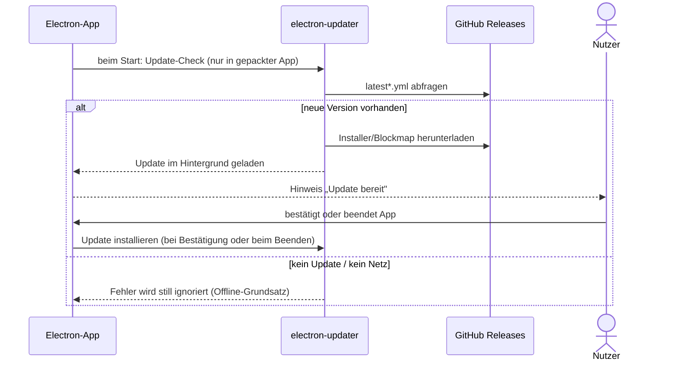

---

## 7. Verteilungssicht

Es gibt keine eigene Server-Infrastruktur. „Verteilung" bedeutet hier: wie
gelangt der gebaute Code auf die Endgeräte, und wie läuft die CI/CD-Pipeline
dorthin.

### 7.1 Infrastruktur Ebene 1: Build- und Distributionskette

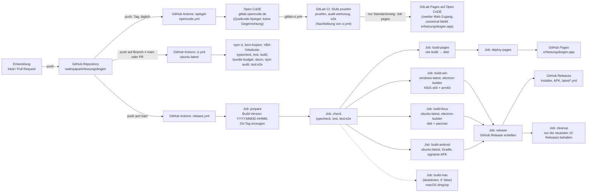

### 7.2 Infrastruktur Ebene 2: Auslieferung an Endgeräte

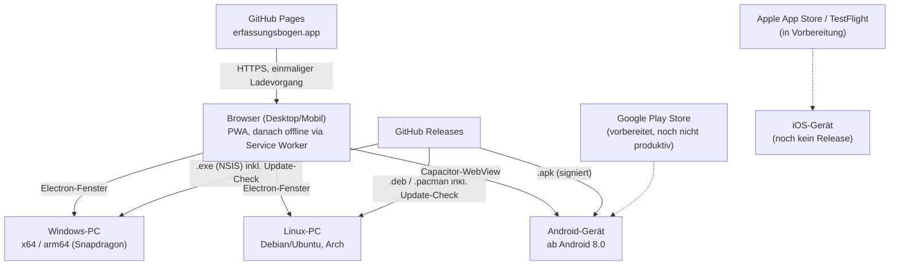

### 7.3 Zielplattformen im Detail

| Plattform | Technologie | Artefakt | Verteilweg | Auto-Update |
| --- | --- | --- | --- | --- |
| Web/PWA | Vite-Build, Service Worker (Workbox) | `dist/` (statische Dateien) | GitHub Pages (erfassungsbogen.app), Deployment bei jedem Push auf `main` | Service-Worker-Update-Banner, kein Auto-Reload |
| Windows | Electron + electron-builder, NSIS | `.exe` (x64 und separat arm64, je eigener Installer) | GitHub Releases | electron-updater, Hintergrund-Download, Installation nach Bestätigung oder beim Beenden |
| Linux | Electron + electron-builder | `.deb` (Debian/Ubuntu), `.pacman` (Arch) | GitHub Releases | electron-updater |
| macOS | Electron + electron-builder | `.dmg`, `.zip` | Stillgelegt (`build-mac` mit `if: false`, die Signatur scheitert auf dem CI-Runner); Verweis auf die Web-App | – |
| Android | Capacitor + Gradle | signierte `.apk` (Release-Keystore aus GitHub Secret) | GitHub Releases; Play Store vorbereitet, noch nicht produktiv | kein In-App-Updater dokumentiert; manueller Download neuer APK |
| iOS | Capacitor + Xcode | – | App Store/TestFlight in Vorbereitung (`docs/TODO.md`); bis dahin Verweis auf die Web-App | – |

### 7.4 Besonderheiten der Pipeline

- **Concurrency-Schutz gegen doppelte Deployments:** `release.yml` gruppiert nach
  `${{ github.workflow }}-${{ github.sha }}` – ein doppelt ausgelöster Lauf für
  denselben Commit bricht sich selbst ab, weil GitHub Pages pro Commit nur ein
  Deployment führt.
- `ci.yml` läuft für Zweige/PRs (nicht `main`): `kern-kopien`, die Prüfung des
  VBA-Vokabulars der Format-Portierung gegen `bos-vokabulare`
  (`npm run vokabular:excel-vba -- --pruefen`), Typprüfung, Tests, Build,
  `bundle-budget`, SBOM, beide `npm audit`-Läufe und die E2E-Tests. Der
  `check`-Job in `release.yml` wiederholt davon Typprüfung, Tests, SBOM (als
  Artefakt mit der Build-Version im Namen), `npm audit --omit=dev` und die
  E2E-Tests; die beiden ADR-003-Wächter laufen nur in `ci.yml`.
- **Vollständige Git-Historie nur beim Pages-Build** (`fetch-depth: 0`), weil die
  generierte `sitemap.xml` ihr `<lastmod>` je Seite aus dem letzten ändernden
  Commit liest; ein flacher Checkout ließe das Skript das Datum bewusst weglassen
  statt ein falsches zu erfinden.
- **Windows-Build erzeugt zwei Architekturen in Folge** (zuerst arm64, dann x64),
  weil beide dieselbe `latest.yml` schreiben und die Metadaten am Ende auf das
  x64-Paket zeigen sollen; ARM64 ist kein Nebenschauplatz, da die emulierte
  x64-App auf Snapdragon-Geräten nicht an die Kamera kommt.
- **Erklärfilm nur auf der Website:** `public/video/`
  (MP4 1080p, rund 25 MB, dazu Vorschaubild und WebVTT-Untertitel) landet im
  Pages-Build, aber nicht in den App-Paketen: electron-builder schließt
  `dist/video/**` über `files` aus, der Android-Job ruft vor `cap sync`
  `scripts/ohne-video.mjs` auf (ebenso `npm run ios:sync`). Der Service Worker
  lädt den Film nicht vor (mp4/jpg/vtt stehen nicht in den `globPatterns`);
  die Startseite lädt ihn erst beim Abspielen (`preload="none"`) und blendet
  den Bereich ohne Netz aus. In den Apps steht stattdessen ein Link auf die
  Website. Entstehung und Werkzeuge: `erklaerfilm/README.md`.
- **Release-Aufräumung:** Ein `cleanup`-Job löscht nach jedem erfolgreichen
  Release alte GitHub-Releases/Tags, außer den neuesten 10 (`KEEP: 10`).
- Alle Submodul-Checkouts erfolgen mit `submodules: recursive`, da bereits die
  Typprüfung ohne den geteilten Kern scheitert.

---

## 8. Querschnittliche Konzepte

### 8.1 UI-Konzept

- **Eigenes Design-Token-System statt Utility-Framework.** Bewusster Verzicht auf
  Tailwind (`PRODUCT.md`), um die „Amtlich"-Optik über eigene CSS-Custom-Properties
  zu steuern.
- **Oberflächenschrift Archivo**, als Variable Font aus dem Bundle geladen
  (`@fontsource-variable/archivo`), nicht von einem CDN. Im Produktions-Build wird
  zusätzlich nur das Latin-Subset der `@font-face`-Regel als Base64 in die
  `index.html` eingebettet (`fontCssInline()` in `vite.config.ts`), um einen
  LCP-Repaint zu vermeiden.
- **Drei Anzeigemodi:** Dunkel-, Feld- und Nacht-Modus als reine
  Token-Umschaltung (`src/app/anzeige-modus.ts`), nur per Schalter aktivierbar –
  nie automatisch über `prefers-color-scheme`.
- **Keine Systemdialoge.** Eigene Ersatzfunktionen
  `frageText`/`frageFelder`/`frageJaNein`/`frageWahl`/`zeigeHinweis` in
  `src/app/dialoge.tsx`, gezeichnet von einer global eingehängten
  `<Dialogschicht />`; E2E-Wachhund in `features/support/haken.ts`.
- **Barrierefreiheit ohne verbindlichen Standard:** Kein festgelegtes
  BITV/WCAG-Ziel, aber produktspezifisch etablierter hoher Kontrast (Feld-Modus)
  und Nacht-Modus.
- **Organisationsspezifische Akzentfarben** (`org-farben.ts`) und eingebettete
  taktische Zeichen (`taktische-zeichen-bogen.ts`).

### 8.2 Persistenzkonzept

**Keine Datenbank, kein Server.** Alle Nutzdaten liegen ausschließlich im
`localStorage` des Geräts; kurzlebige Merker einer Sitzung liegen im
`sessionStorage` des Tabs. Jeder Schlüssel der App beginnt mit `eeb.` (Ausnahmen:
`eeb-scanweg`, `eeb-kamera` und die Debug-Schalter) — Datensicherung und „Alle
Daten löschen" erfassen den Bestand über dieses Präfix.

| Schlüssel (`localStorage`) | Inhalt | Baustein |
| --- | --- | --- |
| `eeb.entwurf.v1` | Der eine Arbeitsbogen mit zuletzt offenem Schritt, Vorlagen-Kennung (`vorlageId`) und Stand der letzten Übergabe | `entwurf.ts`, `uebergabe-stand.ts` |
| `eeb.entwurf.ersetzt.v1` | Rückholplatz: genau ein verdrängter Bogen, optional mit Anlass (`ersetztGrund`) | `entwurf.ts` |
| `eeb.entwurf.beschaedigt.v1` | Ein Entwurf, den die App nicht lesen kann, unverändert; fällt nach 90 Tagen weg | `entwurf.ts` |
| `eeb.vorlagen.v1` | Gespeicherte Vorlagen einschließlich Papierkorb (30 Tage) | `vorlagen.ts` |
| `eeb.musterung.v1` | Haken der Musterung „Einsatz vorbereiten" (Vorlagen-Kennung, Wahrheitswerte je Stelle, Zeitpunkt; keine Namen) | `musterung-stand.ts` |
| `eeb.personalstamm.v1` | Personalstamm des Geräts: die Helferliste einer Dienststelle, auch Personen, die nicht im Einsatz sind | `personalstamm.ts` |
| `eeb.absenderkarte.v1` | Freiwillige Absenderkarte | `absenderkarte.ts` |
| `eeb.geraeteschluessel.v1` | Privater Ed25519-Schlüssel des Geräts | `geraete-schluessel.ts` |
| `eeb.unlesbar.v1` | Beiseitegelegtes: unlesbare Sammlungen, Meldungen, Vorlagen und ganze Texte (auch die Absenderkarte, `texte[].art`), 90 Tage | `unlesbar.ts`, `unlesbar-aufraeumen.ts` |
| `eeb.uhr.v1` | Zuletzt gesehener Stand der Geräteuhr für die Plausibilitätsprüfung | `datenschutz-uhr.ts` |
| `eeb.sicherung.zuletzt.v1`, `eeb.sicherung.stand.v1` | Zeitpunkt und Umfang der letzten Datensicherung | `sicherung.ts` |
| `eeb.offline-zusatz.v1` | Stand der zweiten Stufe des Offline-Vorrats | `offline-bereit.ts` |
| `eeb.geschlecht-geprueft.v1` | Prüfsummen bestätigter Besetzungen, damit der Hinweis auf die Geschlechts-Vorbelegung bei „alle männlich" abgeschaltet werden kann, ohne das Transportformat zu ändern; keine Namen | `geschlecht-geprueft.ts` |
| `eeb.beispiel-herkunft.v1`, `eeb.beispiel-offen.v1` | Namen und Ziffernfolgen aus einem Übungsbogen, damit das Abwählen von „Übung" daran erinnert, und die Prüfsumme des unverändert offenen Beispiels; beide verschwinden, sobald kein Bogen offen ist | `beispiel-herkunft.ts` |
| `eeb.schnellOrganisation.v1` | Zuletzt gewählte Organisation der Schnellerfassung (eine Zahl) | `schnell-organisation.ts` |
| `eeb.anzeigemodus.v1` | Dunkel-/Feld-/Nacht-Modus | `anzeige-modus.ts` |
| `eeb-scanweg`, `eeb-kamera` | Kamera oder Handscanner, zuletzt gewählte Kamera; keine Personendaten | `handscanner.ts`, `kamera.ts` |
| `eeb.einsaetze.v1` und die übrigen `SAMMLUNGS_SCHLUESSEL` | Altbestand der Einsatz-Sammlung (Sammlungen, Export-, Lageblatt-, Weitergabe- und Kenntnis-Stände, Lagemonitor-Angaben, Papierkorb der Meldungen, Abschluss, Widersprüche); `eeb.aufgeraeumt.v1` nennt ruhende Sammlungen, die der Kern aufgeräumt hat | `meldekopf-altbestand.ts`, `einsaetze-lesen.ts`, `aufraeum-hinweis.ts` |

| Schlüssel (`sessionStorage`) | Inhalt | Baustein |
| --- | --- | --- |
| `eeb.rueck.meldekopf` | Marke „aus der Meldekopf-App geöffnet" (Inhalt „1") | `meldekopf-app.ts` |
| `eeb.wartet.fragment` | Link eines Bogens, zu dem die Rückfrage noch offen ist; nach einem Neuladen wie ein Fragment der Adresszeile gelesen | `wartender-link.ts` |
| `eeb.abgleich.fortsetzen` | Inhaltsleerer Merker nach „Stand aus dem anderen Fenster laden", damit die neu geladene Seite im Bogen beginnt | `fenster-abgleich.tsx` |
| `eeb.personal.rueckweg`, `eeb.fahrzeug.rueckweg`, `eeb.ebene.rueckweg`, `eeb.einsatz.rueckweg`, `eeb.vorbelegung.rueckweg` | Rückweg für „Rückgängig" nach Entfernen bzw. „Für neuen Einsatz vorbereiten": 15 Minuten und nur, solange der Bogen noch so aussieht wie direkt danach | `rueckweg-sitzung.ts`, `einsatz-vorbereiten.ts`, `vorbelegung-rueckweg.ts`, `schritte/personal.tsx` |
| `eeb.funkruf.merker.<Index>` | Funkrufname eines Fahrzeugs nach dem Ausschalten, 15 Minuten | `rueckweg-sitzung.ts` |
| `eeb.ansicht-stelle.v1` | Ansicht-Kennung und Bildlaufstelle für das Neuladen, höchstens 12 Stunden | `ansicht-stelle.ts` |
| `eeb.beispiel-pfad.v1` | Zuletzt offener Ordner des Übungsbögen-Dialogs | `beispiele-dialog.tsx` |

**Der Arbeitsbogen** (`entwurf.ts`):

- **Entwurfswiederherstellung:** Ein gerade ausgefüllter, noch nicht übergebener
  Bogen geht bei Neuladen/Absturz nicht verloren. Ein Entwurf, den die App nicht
  lesen kann (abgeschnitten, Pflichtfeld fehlt, `entwurfPruefen`), wird
  unverändert unter `eeb.entwurf.beschaedigt.v1` beiseitegelegt, statt vom
  nächsten Autosave überschrieben zu werden; die Startseite nennt die Ursache und
  bietet „Als Datei sichern" an.
- **Rückholplatz:** Ein verdrängter Bogen wartet auf genau einem Platz
  (`eeb.entwurf.ersetzt.v1`); die Rückfrage nennt vorher, wenn dabei ein dort
  liegender Bogen fiele. Der Platz trägt als Stand die letzte Bearbeitung des
  Bogens. `merkeVerdraengt` legt die Bearbeitung einer gespeicherten Vorlage
  unverändert gar nicht und verändert nur ohne eigenen Bogen dorthin. Schließen,
  Ersetzen und Zurückholen legen den Bogen bei vollem Speicher vom Entwurfsplatz
  auf den Rückholplatz um; gelingt auch das nicht, bleibt er offen und die Meldung
  bietet die Datei an (`bogen-ablage-voll.ts`).
- **Eingehende Bogen-Links** laufen bei laufender App (`hashchange`, Universal
  Link) über eine Ref auf den Handler des aktuellen Renders und beim Kaltstart
  nach dem Mounten über denselben Weg (`uebernimmBogen`): erst Rückfrage, dann
  verdrängen. Sofort geöffnet wird ein Start-Link nur ohne angefangenen Bogen und
  ohne Altbestand an Sammlungen. Entschieden wird das in `startLage()` beim ersten
  Aufbau der App, nicht beim Laden des Moduls, weil `main.tsx` `app.tsx`
  importiert, bevor `speicherVerdrahten()` dem Kern seinen Speicher reicht.
  „Aus Datei laden…" fragt erst nach dem Lesen (Kapitel 6.3). Gleicht ein
  eintreffender Bogen dem offenen (`bogenSchonOffen`), wird nichts ersetzt und
  nichts vom Rückholplatz verdrängt.
- **Zwei Fenster:** `entwurfAusAnderemFenster` erkennt einen Entwurf, den dieses
  Fenster nicht selbst geschrieben hat. Ein Konflikt entsteht nur bei
  Inhaltsunterschied (`fenster-unterschied.ts`); die feste Warnleiste nennt Felder
  und Zeit. „Meine Fassung behalten" legt den Stand des anderen Fensters auf den
  Rückholplatz, „Stand aus dem anderen Fenster laden" die eigene Fassung. Hat das
  andere Fenster den Entwurf entfernt („Alle Daten löschen", Bogen geschlossen),
  schreibt dieses Fenster ihn nicht zurück (`entwurfFremdEntfernt`), sondern
  bietet „Neu laden, hier verwerfen" und „Bogen hier wieder speichern" an
  (`fenster-abgleich.tsx`). Ein Fenster ohne offenen Bogen baut sich nach „Alle
  Daten löschen" im anderen neu auf.
- **Zurück-Geste:** Ein Beobachter legt für jedes offene `<dialog>` einen
  Verlaufseintrag an (`dialogVerlaufVerdrahten`, `modal-overlay.ts`); Zurück
  schließt zuerst das oberste offene Fenster wie Escape. QR-Vollbild und Scanner
  führen ihren Rücksprung selbst (`data-zurueck="eigen"`). Verlaufseinträge tragen
  die Kennung des Seitenaufrufs — kein „Zurück" in eine Zeit vor dem Neuladen.
- **Stand der Übergabe** (`uebergabe-stand.ts`): Der Entwurf merkt Zeitpunkt, Weg
  und Inhaltskennung der letzten Übergabe; Startseite, Übersicht und
  Übergabe-Dialog sagen, ob der Bogen sich seitdem geändert hat.

**Vorlagen** (`vorlagen.ts`): Papierkorb statt endgültigem Löschen – Prinzip
„Nichts geht verloren" (`PRODUCT.md`); die Frist von 30 Tagen kommt aus
`@bos/meldekopf/papierkorb`. Einzelne Vorlagen lassen sich ohne Komplett-Sicherung
weitergeben: „Vorlage teilen" erzeugt einen signierten Vorlagen-QR/-Link (Marker
`V.`, nicht segmentiert — passt die Vorlage nicht in einen Code, bleiben Link und
Datei) oder eine JSON-Datei (`format: "eeb-vorlage"`, ohne Geräteschlüssel), die
„Aus Datei laden…" vor der Bogen-Rückfrage als Vorlage erkennt. Die Rückfrage
beim Ersetzen einer Vorlage nennt die Unterschiede (`vorlagen-unterschied.ts`).
Personen, die bei „Einsatz vorbereiten" abgewählt wurden, hält
`vorlage-nachzuegler.ts` für Nachzügler bereit.

**Personalstamm** (`personalstamm.ts`): „Neuen Bogen erstellen" öffnet bei
vorhandenem Stamm zuerst „Wer ist dabei?", Schritt 3 bietet „Aus Personalstamm
hinzufügen…". Der Stamm ist an das Gerät gebunden: Die Datensicherung lässt den
Schlüssel aus und spielt ihn nicht ein (`BEIM_GERAET` in `sicherung.ts`); die
Startseite nennt das Datum des Einlesens und erinnert, wenn der Stamm älter als
90 Tage ist. Datenmodell und Transportformat kennen ihn nicht.

**Hüllen zwischen Kern und Speicher.** `speicher-browser.ts` ist die einzige
Stelle, die `localStorage` mit dem Kern `@bos/meldekopf` verbindet. Der Kern in
`vendor/` wird dafür nicht geändert (ADR-003); die App legt drei Hüllen um die
Ablage, vom Speicher nach außen:

1. **Beobachter** (`aufraeum-hinweis.ts`): merkt sich ruhende Sammlungen, bevor
   der Kern sie nach 90 Tagen löscht, damit die Startseite sie nennen kann.
2. **Uhrkorrektur** (`uhr-korrektur.ts`): zeigt dem Kern, der Aufräum- und
   Papierkorbfrist mit `Date.now()` rechnet, bei unplausibler Geräteuhr die
   geprüfte Zeit, indem sie `geaendert`/`geloeschtAm` beim Lesen um den Versatz
   verschiebt und beim Schreiben zurück (Versatz je Seitenaufruf fest, bei
   nachgehender Uhr negativ).
3. **Schonende Hülle** (`speicher-schonend.ts`): überspringt Schreibvorgänge mit
   unverändertem Text (der Kern schreibt bei jedem Lesen die ganze Liste zurück,
   weil `fristBereinigt()` immer ein neues Array liefert) und verschluckt ein
   scheiterndes Zurückschreiben bei reinen Lesezugriffen.

Die Oberfläche liest über `einsaetze-lesen.ts` (gemerktes Ergebnis bei gleichem
Speichertext innerhalb einer Minute, Prüfung jedes Bogens über
`bogen-pruefung.ts`). In dieser App bedient die Schicht nur den Altbestand; die
Vorlagen und der Entwurf haben eigene Ablagen.

**Unlesbares wird beiseitegelegt, nicht verworfen** (`unlesbar.ts`): Ein
Gesamttext von `eeb.einsaetze.v1` oder `eeb.vorlagen.v1`, der sich nicht als Liste
lesen lässt (abgebrochenes JSON, fremder Wert), wandert vor jedem Lesezugriff
unverändert nach `eeb.unlesbar.v1`; ebenso einzelne unlesbare Sammlungen,
Meldungen, Vorlagen und eine beschädigte Absenderkarte. Schlägt das
Beiseitelegen fehl (Speicher voll), lässt die Hülle kein Überschreiben von
`eeb.einsaetze.v1`, `eeb.vorlagen.v1` und `eeb.entwurf.v1` zu; die Startseite
meldet „Speicher voll – beschädigte Daten nicht gesichert". Unlesbares ist Teil
der Datensicherung; „Beiseitegelegtes entfernen…" ersetzt den Originaltext durch
den lesbaren Rest (`unlesbar-aufraeumen.ts`).

**Datenschutzfrist:** 90 Tage nach dem Stand eines Bogens werden seine
Personaldaten dauerhaft anonymisiert. Das gilt für den Entwurf, den Bogen auf dem
Rückholplatz, jeden eingelesenen Bogen und die Meldungen des Altbestands;
Übungsbögen und Vorlagen sind ausgenommen.

- **Regel:** liegt im Format (`@bos/eeb-format/datenschutzfrist`).
- **Kein Schemafeld:** Die Frist leitet sich aus `stand` und `uebung` ab und gilt
  so auch für schon verteilte QR-Codes.
- **Uhr:** reicht das Produkt herein (`datenschutzUhrSetzen` in
  `speicher-browser.ts`, gemerkter Stand unter `eeb.uhr.v1`). Ohne hereingereichte
  Uhr anonymisiert der Kern nichts — wie bei der Speicherhülle.
- **Geprüfte Geräteuhr** (`datenschutz-uhr.ts`): `geraeteuhrPruefen(jetzt, bisher,
  faelligWuerde)` hält einen Abstand von mehr als 60 Tagen zum letzten Start fest
  (`gehalten`, `richtung` vor oder zurück; das Format-Maß `UHR_SPRUNG_TAGE = 366`
  ließe ein falsches Jahr durch) und bestätigt ihn nie durch Zeitablauf, sondern
  nur durch `uhrBestaetigen()` („Geräteuhr stimmt" mit Rückfrage, die
  `uhrFolgen()` in Zahlen nennt) oder wenn die Uhr wieder innerhalb von 60 Tagen
  zum letzten Start passt. Ein Sprung nach vorn, bei dem `faelligWuerde()` nichts
  findet (`uhr-folgen.ts` liest die rohen Einträge ohne die Hüllen: ruhende
  Sammlungen, Papierkorb, abgelaufene Bögen, Entwurf), ist eine echte Pause und
  wird ohne Frage übernommen; würde Unangekündigtes fällig, fragt die App auch
  unter 60 Tagen. Die Oberfläche warnt „Geräteuhr prüfen" (`uhr-warnung.tsx`).
- **Stempel:** Neue Stände (Bogen, Vorlage) nehmen `stempelZeitpunkt()`, also die
  geprüfte Zeit; Vorlagen und Papierkorb-Anzeige (`papierkorb-frist.ts`) rechnen
  mit `geprueftesJetztMs()`.

**Datensicherung und Löschen** (`sicherung.ts`):

- **Sicherung:** expliziter Export aller `eeb.`-Einträge als JSON-Datei
  (`format: "eeb-sicherung"`), einschließlich Absenderkarte, Geräteschlüssel,
  Beiseitegelegtem und Altbestand. Drei Schlüssel gehören zum Gerät und bleiben
  beim Einspielen stehen und außen vor (`BEIM_GERAET`): der Uhrstand, der Stand
  des Offline-Vorrats und der Personalstamm.
- **Einspielen:** Die Rückfrage nennt den Umfang von Gerät und Datei, Beschädigtes
  der Datei (`BestandUmfang.beschaedigt`) und was aus einer alten Datei sofort
  wieder unter die Fristen fällt (`bestandUmfang().faellig`). Scheitert das
  Schreiben, schreibt `sicherungEinspielen` den vorherigen Bestand zurück und
  meldet auf Deutsch, ob die Daten unverändert sind.
- **Alle Daten löschen** (`alleDatenLoeschen`): nennt den Umfang und entfernt alle
  `eeb.`-Einträge samt der Merker im `sessionStorage`.
- **Altbestand löschen** (`altbestandLoeschen`): entfernt gezielt die
  `SAMMLUNGS_SCHLUESSEL`, mit Rückfrage; Vorlagen, eigener Bogen und Einstellungen
  bleiben.
- **Geräteschlüssel:** „Geräteschlüssel neu erzeugen" in der Fußzeile verwirft
  ihn und legt sofort ein neues Paar an, ohne die Bogendaten anzufassen — der
  technische Teil von Maßnahme M3 des
  [Informationssicherheitskonzepts](informationssicherheitskonzept.md).
- **Dauerhafter Speicher:** Im Web bittet die App um `navigator.storage.persist`,
  sobald wertvolle Daten vorliegen, und zeigt das Ergebnis in der Datensicherung.

**Schreiben wird quittiert, wenn es gelang.** Scheitert ein Schreibvorgang
(Speicher voll, gesperrt), sagt die feste Warnleiste „Nicht gespeichert" mit
Ursache (`speicher-warnung.tsx`, `speicher-fehler-text.ts`); blockiert der Browser
den Speicher ganz, steht „dieser Browser speichert nichts" statt „Alle Daten
bleiben auf diesem Gerät".

### 8.3 Sicherheits- und Datenschutzkonzept

- **Content-Security-Policy** wird ausschließlich im Produktions-Build als
  `<meta>`-Tag injiziert (`contentSecurityPolicy()` in `vite.config.ts`):
  `default-src 'self' file:`, `object-src 'none'`, `base-uri 'none'`,
  `form-action 'none'`, `frame-src 'self' file: blob:`; `connect-src`/`img-src`
  sind auf den eigenen Ursprung plus einen einzigen externen Host beschränkt
  (`erfassungsbogen.goatcounter.com`). `script-src` gibt die drei
  Inline-`<script>`-Blöcke der `index.html` einzeln über beim Bauen erzeugte
  `sha256`-Hashes frei und kommt damit **ohne `'unsafe-inline'`** aus;
  `'wasm-unsafe-eval'` erlaubt zusätzlich das Kompilieren des
  WebAssembly-Decoders ZXing aus dem eigenen Bundle. `style-src` behält
  `'unsafe-inline'`, weil React `style`-Attribute an Elementen setzt. `file:`
  deckt den Electron-Build ab. Der Link zur Meldekopf-App ist eine Navigation und
  braucht keinen Eintrag.
- **Entpack-Grenze beim Import:** Der in den Codec hineingereichte
  `browserKompressor` (`src/app/hilfen.ts`) nutzt `inflateRawBegrenzt` mit
  `MAX_ENTPACKT = 4 MiB` und prüft streamend — eine präparierte Datei kann den
  Speicher nicht vollaufen lassen. Der Word-Import nutzt dieselbe Funktion mit
  eigenem Deckel (8 MiB für `word/document.xml`, Datei höchstens 25 MiB).
- **Software-Lieferkette:** `npm run sbom` (`scripts/sbom.ts`) erzeugt eine
  CycloneDX-1.6-Stückliste aus den fünf `package-lock.json` ohne Installation
  und ohne Netz; `npm audit --omit=dev --audit-level=high` blockiert im CI,
  `npm audit` über das Bau-/Testwerkzeug läuft als Hinweis mit; Dependabot
  (`.github/dependabot.yml`) prüft wöchentlich npm und GitHub-Actions.
  `softprops/action-gh-release` ist in `release.yml` auf einen Commit-Hash
  gepinnt.
- **Keine Anmeldung, keine Cloud**, keine personenbezogenen Daten verlassen das
  Gerät außer über den vom Nutzer selbst gewählten Transportweg. Dazu zählt „An
  Meldekopf-App geben": Der Bogen steht im URL-Fragment, das der Browser nicht an
  den Server sendet.
- **Cookielose Reichweitenmessung** über GoatCounter – der einzige erlaubte
  Fremd-Host in der CSP (`statistik.ts`: ein Treffer pro Kaltstart und wenige
  feste Ereignisse).
- **Ed25519-Signatur** jedes von der App erzeugten QR-Codes (Container `EEB2C`).
  Der Geräteschlüssel wird lokal beim ersten Bedarf erzeugt; lässt er sich nicht
  speichern, gilt er nur für die offene Seite — die Übergabe scheitert nie am
  Schlüssel. Die Verifikation ist rein informativ und blockiert den Import nie.
  Ein Schlüsselwechsel ist jederzeit möglich (Fußzeile), wird aber nicht
  verkündet: Ohne PKI gibt es keinen Widerruf, die Gegenstelle gleicht die neue
  Kurzform von Hand ab.
- **Meldeweg für Schwachstellen:** `SECURITY.md` im Hauptrepository, gültig für
  das Hauptrepo und die vier `vendor/`-Submodule (Private Vulnerability
  Reporting auf GitHub oder E-Mail, keine öffentlichen Issues).
- **TOFU-Vertrauensmodell**, keine zentrale PKI: „✓ signiert von …" belegt nur,
  dass der Datensatz unverändert vom Inhaber dieses Schlüssels stammt – nicht,
  wer diese Person ist.
- **Signaturkette beim Weiterreichen (Gegenzeichnen):** ein unverändert
  weitergereichter Bogen wird um eine zusätzliche Stufe ergänzt statt neu
  signiert (bis zu 32 Stufen, `MAX_STUFEN` in `codec.ts`).
- **Absenderkarte ist Eigenangabe**, keine Identitätszusicherung.
- **Electron-Härtung:** `contextIsolation: true`, `nodeIntegration: false`,
  `sandbox: true`; nur die Berechtigungen `media` (Kamera), `clipboard-read` und
  `clipboard-sanitized-write` werden gewährt, alles andere pauschal abgelehnt.
  Externe Adressen öffnet der Systembrowser; neue Fenster lehnt
  `setWindowOpenHandler` ab, mit einer Ausnahme für Adressen mit `?lagemonitor=`,
  die diese App nicht erzeugt (Kapitel 11.3).

### 8.4 Kompatibilitätskonzept (Schema-Evolution)

- **Schema-Version aktuell 13** (`vendor/eeb-format/src/model.ts`); Historie: v1
  (THW-spezifisch) → v2 (organisationsübergreifend) → v3 (Ernährungsform je
  Person) → v4 (ein Kennzeichen-Feld) → v5 (Einheitsname in der Hierarchie) → v6
  (Übungs-Kennzeichnung) → v7 (stand minutengenau) → v8 (mehrere
  Fahrerlaubnisklassen je Person) → v9 (abweichende Sitzplatzzahl je Fahrzeug)
  → v10 (abweichende Dienststelle je Person) → v11 (Einsatzzeitraum mit Uhrzeit
  als ISO 8601) → v12 (Funkrufname als Erreichbarkeit einer Person, `KontaktArt.FUNK`)
  → v13 (abweichende Farbe des taktischen Zeichens je Fahrzeug, `Fahrzeug.zeichenfarbe`).
- **Freitext-Konventionen statt Schema-Sprung:** Wo eine Angabe nur Text ist und
  jeder Leser sie auch ohne Vokabular verstehen soll, bleibt das Format
  unberührt — die DLRG-Ausbildungskennzahl steht als Freitext
  „411 Wasserretter …", ein Beruf als „Beruf: Elektroniker/in" im Feld
  `zusatzqualifikationen` (`src/app/beruf.ts`). Nur die App trennt daran ihre
  Eingabefelder; ein älterer App-Stand und der Meldekopf-Filter zeigen den
  Klartext. Ebenso „Zeitraum nicht angegeben": Tag 0 (01.01.2020) an beiden
  Enden des Zeitraums (`zeitraumLeer`, Kapitel 6.4).
- **Abwärtskompatibilität ist Pflicht:** `decodeBinaer` und
  `bogenLaden`/`migriereBogen` akzeptieren jede Version `2..SCHEMA_VERSION`,
  füllen fehlende Felder mit Defaults, überführen entfallene Felder (Beispiel: v2
  `Sofortbedarf.davonVegetarisch` → `verpflegungManuell`) und heben den Bogen
  anschließend auf die aktuelle Version.
- **Vorwärtskompatibilität über die kleinste tragende Version**
  (`transportSchemaVersion`): Ein Bogen ohne Übungs-Flag bleibt Schema 5 und
  damit für ältere App-Stände lesbar; erst ein Übungsbogen fordert Schema 6 – und
  wird von älteren Versionen dann bewusst mit „nicht unterstützte
  Schema-Version" abgelehnt, statt eine Übung unmarkiert wie einen echten Einsatz
  anzuzeigen.
- **Bewusste Ausnahme: Einzelperson** (`einheit.einzelperson`). Das
  Kennzeichen für eine einzeln anrückende Person (Fachberater/in u. a.) belegt
  ein freies Bit im Kopf der Einheit und fordert **keine** höhere
  Schema-Version. Ältere Stände überlesen es und zeigen den Bogen als Einheit
  mit Stärke 0/0/1//1 und dem Funktionsnamen als Typ – so, wie eine Einzelperson
  ohne das Kennzeichen zu melden wäre. Die Abwägung ist die umgekehrte wie bei der Übung: Die
  ungenaue Anzeige schadet nicht, ein am älteren Meldekopf abgelehnter Bogen
  schon. `einzelpersonAbgleich` (`src/app/hilfen.ts`) hält den Einheitstyp dafür
  gleich der ersten Funktion der Person.
- **Vorbelegung mit Folgen:** Schritt 2 belegt die Uhrzeiten des Zeitraums mit
  08:00 und 18:00 vor (`einsatzVorgabe` in `src/app/zeitraum-eingabe.ts`); den
  Zeitzonen-Offset setzt die App aus der Gerätezeitzone. Ein neu angelegter Bogen
  mit Zeitraum ist damit mindestens Schema 11 und für App-Stände davor nicht
  lesbar.
- **Golden-Fixture-Tests** (`vendor/eeb-format/src/codec.migration.test.ts`,
  `features/fixtures.ts`) frieren echte QR-Payloads als Konstanten ein — einen
  v2-Bogen und je einen Bogen der Schemata 8 bis 12; diese Bytes dürfen sich nie
  ändern. Jede Fixture sichert den Datenstrom vor dem Merkmal der nächsten
  Version ab: v8 ohne Sitzplatzzahl, v9 ohne Dienststelle je Person, v10 ohne
  Uhrzeit zum Zeitraum, v11 ohne Funkrufname als Erreichbarkeit, v12 ohne
  Zeichenfarbe am Fahrzeug.
- **Portierungen:** Die Leser unter `vendor/eeb-format/ports/` (VBA) stehen auf
  demselben Schema-Stand (`PORT.json`: 13) und werden mit jeder Formatänderung
  nachgezogen; `npm run ports:testvektoren` und `npm run ports:pruefen` im
  Format-Repo halten sie gegen die Testvektoren.
- **Bewusste Ausnahme (v4):** das historische THW-Kennzeichen-Sonderformat (Zahl
  statt String) wird beim Decodieren aus QR-Codes nur übersprungen (Feld bleibt
  leer), in JSON-Dateien/Vorlagen dagegen aktiv migriert (84397 → „THW-84397").

### 8.5 Kompressions- und Transportkonzept

- **Namensraumbasierte Vokabulare:** Der `OrganisationsTyp` (1 Byte) wählt einen
  Namensraum, innerhalb dessen Einheitstyp, Funktionen, Fahrzeugtyp,
  Hierarchie-Ebenen und Qualifikationen als 1-Byte-Codes aufgelöst werden; jeder
  Vokabular-Wert hat einen Freitext-Ausweg (`code 0` + String).
- **Optionale Felder kosten ein Flag-Bit, nicht ein Byte:** die Sitzplatzzahl je
  Fahrzeug (ab v9) belegt Bit 32 des Fahrzeug-Flag-Bytes und schreibt nur dann
  ein zusätzliches Byte, wenn die Einheit vom Richtwert des Typs abweicht.
  Ebenso die Farbe des taktischen Zeichens (ab v13, `Zeichenfarbe.KOMMUNAL` = 1,
  `GRAU` = 2): Bit 64 und ein Byte am Ende des Fahrzeug-Blocks, nur bei Gerät
  von Partnern, das eine Einheit führt (Anhänger der Gemeinde, Abrollbehälter
  des Havariekommandos). Die Uhrzeiten des Einsatzzeitraums (ab v11) belegen die
  Einsatz-Flags 4 und 8 und je 3 Byte. Die Einzelperson belegt ein freies Bit im
  Kopf der Einheit. Der Funkrufname einer Person (ab v12) braucht kein neues
  Bit: Er steht als String wie eine Adresse.
- **Bitweise Kodierung häufiger Enums** (Geschlecht, Ernährung, Stärkerolle je 2
  Bit; Fahrerlaubnisklasse 4 Bit), BCD-gepackte Telefonnummern, Datum/Zeit als
  kompakte Ganzzahl seit einem festen Referenzdatum.
- **Pipeline:** Binärstrom → DeflateRaw (pako) → Base41 → alphanumerischer
  QR-Modus. Base41 (41-Zeichen-Alphabet, angelehnt an Base45/RFC 9285, aber
  URL-sicher) nutzt den alphanumerischen QR-Modus (5,5 Bit/Zeichen) statt des
  Byte-Modus (8 Bit/Zeichen) – gemessen über 227 Übungsbögen liegt die mittlere
  QR-Version bei 17,66 statt 20,50 mit Base64url.
- **Zwei Formate je nach Zweck:** Der QR-Code nutzt Base41 (`B.`-Marker); der
  teilbare Textlink bleibt bewusst Base64url, weil Base41-Sonderzeichen
  (`$ * / :`) in Chat-Programmen die Link-Erkennung zerstören würden.
- **Segmentierung als Fallback:** Nur wenn ein Bogen das Zielbudget
  (≤ QR-Version 18, Fehlerkorrektur M, ≈512 Payload-Bytes) überschreitet, wird
  der Payload auf mehrere `EEBS.`-QR-Codes (je ≤ Version 13) aufgeteilt; eine
  32-Bit-Prüfsumme (FNV-1a) bindet die Teile aneinander.
- **Gemessene Größen:** voller THW-Bogen 511 Bytes → QR-Version 18 (mit
  Ortsverbands-Referenz: 411 Bytes → Version 15); Meldekopf-Schnellerfassung
  191 Bytes → Version 10.

### 8.6 Testkonzept

- **Zwei Vitest-Projekte** (`vitest.config.ts`): `logik` (Node, `.test.ts`) und
  `oberflaeche` (jsdom + Testing Library, `.test.tsx`, u. a. der komplette
  Assistenten-Durchlauf in `app.test.tsx`).
- **Cucumber.js + Playwright** für Verhaltenstests: Gherkin-Szenarien auf Deutsch
  unter `features/*.feature`, gefahren gegen den produktiven Build
  (`vite preview`), nicht gegen den Dev-Server – weil pdfmake im Dev-Server beim
  Rendern hängt. `EEB_BROWSER=webkit` erlaubt eine Näherung an die
  iOS-WKWebView.
- **Wachhund gegen Systemdialoge und Portprüfung vor Testlauf-Start**
  (Fehlschlag mit Klartext-Meldung, falls Port 5273 belegt ist).
- **Golden-Fixture-Migrationstests** (siehe 8.4) sichern reale Altdaten ab.
- **Tests am Papier:** `pdf-seiten.test.ts` und `pdf-sammel.test.ts` setzen echte
  PDFs und prüfen Seitenzahlen; `scripts/blanko-vordruck.test.ts` vergleicht den
  ausgelieferten Blanko-Vordruck byte-genau mit einem neu erzeugten.
- **Tests am Stylesheet und am Startbündel:** `stilregeln-*.test.ts` schützen
  Layoutregeln der `index.html`; `startbuendel-wacht.test.ts` und
  `startbuendel-nachladen.test.tsx` halten fest, was nicht ins Startbündel darf
  und was nachgeladen wird.
- **CI-Gates als Architekturtests:** `npm run kern-kopien` und
  `npm run bundle-budget` laufen im Prüflauf `ci.yml`, dazu
  `npm run vokabular:excel-vba -- --pruefen`, `npm run sbom` (Stückliste als
  Artefakt) und `npm audit` (blockierend über die Laufzeit-Abhängigkeiten, als
  Hinweis über das Bau-/Testwerkzeug).
- **Bewusst zurückgestellt:** native Gerätetests für Kamera-Scanner, Filesystem
  und Share (WebdriverIO/Appium) als „teuerster, zuletzt zu automatisierender
  Teil" (`docs/tests.md`, Ausbaustufe 3).

### 8.7 Build- und Generierungskonzept

| Artefakt | Erzeugt von | Grund |
| --- | --- | --- |
| `sitemap.xml` | `scripts/sitemap.ts` (Vite-Plugin `eeb-sitemap`) | `<lastmod>` je Seite aus dem letzten ändernden Git-Commit; entfällt bei flachem Checkout mit Warnung statt Falschangabe. |
| Versionsangabe im Footer (`%APP_VERSION%`) und `dateModified` der strukturierten Daten (`%BUILD_DATE%`) | `bauStempel()`-Plugin | Muss der tatsächlichen Release-/Build-Version entsprechen. |
| Content-Security-Policy (inkl. `sha256`-Hashes der Inline-Skripte) | `contentSecurityPolicy()`-Plugin | Nur im Build aktiv, da der Dev-Server HMR-WebSocket/Inline-Eval braucht; die Hashes müssen zum fertig transformierten HTML passen, das Plugin läuft deshalb zuletzt. |
| SBOM (`sbom.cdx.json`, CycloneDX 1.6) | `scripts/sbom.ts` (`npm run sbom`) | Zu jedem ausgelieferten Stand gehört die passende Stückliste; wird aus den fünf `package-lock.json` ohne Installation und ohne Netz erzeugt, Seriennummer aus dem Inhalt abgeleitet. |
| Inline-CSS-Minifizierung | `inlineCssMinify()`-Plugin | Design-Token-CSS liegt bewusst inline (kein zweiter Request), soll aber nicht unminifiziert (~10 KB Kommentare/Einrückung) ausgeliefert werden. |
| Font-CSS-Inlining (Archivo, Latin-Subset) | `fontCssInline()`-Plugin | Vermeidet zusätzliche Requests und einen LCP-Repaint durch `font-display: swap`. |
| Kopfnavigation (3 Fassungen: statische Seiten, `index.html`-Gerüst, React-Komponente) | `npm run content-nav`, `scripts/kopfnav.mts`, `src/app/kopfnav-ui.tsx` | Eine Quelle (`src/app/kopfnav.ts`) für drei technisch unterschiedliche Ausgabeorte; ein Test (`kopfnav.test.ts`) erkennt Veralten. |
| Aufteilung des Offline-Vorrats (`offline-zusatz.json`) | `manifestTransforms` mit `scripts/precache-aufteilung.ts` | Kern, Zusatzstufe und „nur auf Abruf" entstehen aus einer Regel im Build (Kapitel 6.4). |
| Stilvorlagen in den Vorladelisten der Chunks | `fontCssInline()` und `writeBundle` in `vite.config.ts` | Die Einbettung der Schrift-CSS ersetzt die `index-*.css`; die Vorladelisten nachgeladener Chunks werden angepasst, sonst scheitert das Nachladen ohne Netz mit „Unable to preload CSS". `bundle-budget` prüft das Ergebnis. |
| Blanko-Vordruck (`public/downloads/einheiten-erfassungsbogen-blanko.pdf`) | `npm run blanko-pdf` | Liegt fertig im Repo, aus derselben Dokumentdefinition wie jede Bogen-PDF; ein Test vergleicht byte-genau. |
| Übungsbögen (`examples/`), Suchindex (`src/app/beispiele-suchindex.json`), Ordnerlisten | `npm run beispiele…`, `npm run beispiele:suchindex` | Erzeugt und eingecheckt, nicht im Build; die Generatoren sind die Quelle. |
| VBA-Vokabular (`vendor/eeb-format/ports/vba/m_digitalerEEBVokabular.bas`) | `npm run vokabular:excel-vba` | Aus `bos-vokabulare` erzeugt und im Format-Repo committet; `ci.yml` prüft mit `--pruefen`, dass das Modul zum Vokabular passt. |
| Themenseiten: Stil, Navigation, Hinweise | `npm run content-stil`, `content-nav` und weitere `content-*`-Skripte | Die 36 statischen Seiten teilen Stilblock und Bausteine aus je einer Vorlage (`scripts/content-stil.mts`). |

### 8.8 Fehler- und Ausnahmebehandlung

- Fehlerpfade sind explizit modelliert und getestet: falsches Magic-Byte,
  Schema-Grenzen, über-/unvollständige Binärdaten (`codec.test.ts`),
  unvollständige QR-Segmentsätze, kaputte/fremde Links
  (`features/daten-und-anzeige.feature`).
- Netzwerkfehler werden dort, wo sie nicht sicherheitsrelevant sind
  (Update-Check, Statistik-Zählpixel), bewusst still ignoriert, um den
  Offline-Grundsatz nicht zu verletzen – siehe Kapitel 6.5.
- **Fehlerfänger** (`src/app/fehlerfaenger.tsx`): Eine React-Fehlergrenze um die ganze App.
  Wirft ein Aufbau der Ansicht einen Fehler, erscheint statt eines weißen
  Bildschirms eine deutsche Meldung („Deine Daten liegen weiter auf diesem
  Gerät") mit Neu laden, Zur Startseite, „Daten sichern"
  (Sicherungsdatei aus allen `eeb.`-Einträgen) und, mit Haken, „Alle Daten
  löschen"; die technische Angabe ist eingeklappt. Die Seite hängt nur an
  `sicherung.ts` und `hilfen.ts`, nicht an den Komponenten, die abgestürzt
  sein können. Lässt sich ein nachgeladener Baustein nicht holen, nennt die
  Meldung die Ursache (`nachladen.ts`) und rät nicht zum Löschen.
- **Pflichtfeldprüfung** (`src/app/bogen-pruefung.ts`): `bogenBefund` ergänzt
  Harmloses (fehlender Einheitstyp → leerer Wert, fehlende Listen, Namen) und
  lehnt Unbrauchbares mit Ursache ab (Einheit, Organisation, Stand,
  Einsatzzeitraum, Personenliste, Erfassungsart). Eingänge: „Aus Datei laden…"
  (`bogenPruefen`), Bögen aus einer PDF (`einsatz-transport.ts`), der Entwurf
  (`entwurfPruefen`) und der gelesene Bestand (`vorlagen.ts`,
  `einsaetze-lesen.ts` für den Altbestand). Der Kern (`einsaetzeAusJson`,
  Submodul) prüft nur die Hülle des JSON; die Schicht sitzt vor ihm.
- **Eine Sperre für alle PDF-Wege** (`src/app/arbeitet.ts`): Bogen-PDF und
  Blanko-Vordruck (Startseite, Übergabe-Dialog, Fußzeile) laufen über
  `arbeiten(name, aktion)`: höchstens eine zugleich, der zweite Tipp tut nichts
  (eine Datei statt zwei), die Oberfläche bekommt vor der schweren Arbeit ein
  Bild (`naechstesBild`), der Knopf zeigt „… wird erzeugt…" (`aria-busy`), und
  die Bestätigung steht unter den Knöpfen (`ausgabeQuittung`).
- **Feste Warnleiste** (`src/app/feste-warnung.tsx`): „Nicht
  gespeichert" und die Konfliktwarnung der zwei Fenster sitzen am oberen
  Bildrand (zwei Zeilen Kurztext, Einzelheiten hinter „Was tun?" bzw.
  „Entscheiden", bei knapper Bildhöhe eingeklappt); die Seite rückt um die
  Leistenhöhe nach unten (`--fest-warnung-hoehe`) und hält sie beim Scrollen zu
  einem Feld frei. Gemessen bei 360 × 640: 130 statt 240 px, bei 360 × 380
  (Tastatur) 53 px.

---

## 9. Architekturentscheidungen

Diese Entscheidungen wurden aus Code-Kommentaren, Commit-Konventionen und den
Projekt-Dokumenten rekonstruiert — einschließlich der vier Kern-Submodule, deren
`README.md`-Dateien ADR-003 wörtlich dokumentieren.

### ADR-003: UI-freier Kern in eigene Submodul-Repositories ausgelagert, mit sechs Aufnahmeregeln

- **Kontext:** Ein zweites Produkt, „S1-Control v2" (Electron-Anwendung mit
  npm-Workspaces), benötigt denselben Codec und dieselbe Meldekopf-Logik wie der
  Erfassungsbogen.
- **Entscheidung:** Vier Bibliotheken (`@bos/eeb-format`, `@bos/meldekopf`,
  `@bos/vokabulare`, `@bos/taktische-zeichen`) liegen in eigenen, öffentlichen
  GitHub-Repositories und werden in beide Produkte als Git-Submodule eingebunden,
  über `file:`-Abhängigkeiten in `node_modules` verlinkt. Der Erfassungsbogen
  bündelt ihre **Quelle** (Vite-Alias `@bos/*` → `vendor/*/src/*.ts`) statt ihres
  gebauten `dist/`; S1-Control konsumiert dieselben Bausteine über deren
  gebautes `dist/`.
- **Die sechs Aufnahmeregeln** (wörtlich aus den vier Submodul-READMEs):
  1. Aufnahme in den Kern nur, wenn beide Produkte den Baustein aufrufen.
  2. Keine `node:`-, DOM- oder React-Importe; maschinell geprüft per ESLint
     (`no-restricted-imports`) und durch Testlauf derselben Testdateien unter
     `node` und `jsdom`.
  3. Keine Rückimporte aus `@s1/*` oder aus der Erfassungsbogen-App.
  4. Änderungen additiv; Schema-Abwärtskompatibilität bleibt Pflicht (QR-Codes
     und Dateien ab Schema 2 müssen lesbar bleiben).
  5. Bundle-Budget im CI von erfassungsbogen.app – der Kern darf die PWA nicht
     schwerer machen.
  6. Gepinnte Submodul-Commits; kein automatisches Folgen von `main`.
- **„Diamant auf eeb-format" (Nachtrag):** `@bos/eeb-format` (und, wo
  einschlägig, `@bos/vokabulare`) ist in `@bos/meldekopf` und `@bos/vokabulare`
  als `peerDependency` eingebunden. Läge das Format ein zweites Mal im
  Abhängigkeitsbaum, sähe TypeScript zwei verschiedene Typen namens „Bogen".
- **„Warum `qr-node.ts` jetzt passt" (Nachtrag):** Aufnahmeregel 2 gilt „je
  Sprachimplementierung", nicht über das ganze Repository hinweg – die
  Node-spezifische QR-Erzeugung darf `node:zlib`/`qrcode`/`Buffer` benutzen, weil
  sie über einen eigenen Einstieg (`@bos/eeb-format/node`) nicht re-exportiert
  und durch eigene tsconfig-/ESLint-Ausnahmen eng eingegrenzt ist.
- **Rückweg (Exit-Strategie):** Blockiert oder verzögert der geteilte Kern
  zweimal in drei Monaten ein Release des Schwesterprodukts, wird das Vendoring
  bewusst eingefroren: Der Stand wird als Kopie in ein eigenes Verzeichnis
  übernommen, der Herkunfts-Commit dort festgehalten, danach werden beide Seiten
  getrennt gepflegt. Der Rückweg gilt ausdrücklich als vorgesehene Option, nicht
  als Scheitern.
- **Konsequenzen:** Submodule sind auf feste Commits gepinnt; zwei CI-Gates
  (`kern-kopien`, `bundle-budget`) erzwingen die Architekturgrenze technisch;
  jedes Submodul hat zusätzlich eine eigene `ci.yml` (lint → typecheck → test
  unter node+jsdom → build). Modulgenaue statt Sammel-Importe verhindern, dass
  große Tabellen ins Startbündel gezogen werden (gemessen: 1.258 KB bei
  Sammel-Import, 839 KB modulgenau). Aus demselben Grund lädt die App schwere
  Teile erst bei Bedarf: PDF-Satz, QR-Decoder, Zeichensammlung,
  Ortsverbandsverzeichnis, Berufe, Übungsbögen-Dialog, Fenster des
  Personalstamms, Word-Import und Änderungsverlauf. `hilfen.ts` rechnet die
  Datenschutzfrist selbst nach, statt `@bos/eeb-format/datenschutzfrist` zu
  importieren, weil der Import das Ortsverbandsverzeichnis ins Startbündel zöge.
- **Referenz:** `docs/entwicklung.md`; `README.md` der vier Submodule.

### ADR-003a: Kein `prepare`-Skript in den Kern-Submodulen

- **Kontext:** `@bos/meldekopf` und `@bos/vokabulare` brauchen zum Bauen die
  Typdeklarationen aus `@bos/eeb-format/dist`.
- **Entscheidung:** Bewusst kein `prepare`-Skript in den vier Kern-Paketen.
- **Begründung:** npm ordnet die `prepare`-Läufe von `file:`-Abhängigkeiten nicht
  nach der Peer-Beziehung – in der CI lief `bos-meldekopf` einmal vor
  `eeb-format` und scheiterte mit `TS2307: Cannot find module '@bos/eeb-format'`
  samt 34 Folgefehlern. Zudem führt npm Install-Skripte von Abhängigkeiten
  inzwischen ohnehin nicht mehr ungefragt aus.
- **Konsequenz:** Wer `dist/` braucht, baut explizit in fester Reihenfolge:
  `eeb-format` → `bos-vokabulare` → `bos-taktische-zeichen` → `bos-meldekopf`.

### ADR-001: Eigener minimaler XLSX-Writer statt SheetJS/exceljs

- **Status:** Zurückgezogen am 2026-11-03 — der Excel-Export der Einheitenliste
  im festen Spaltenformat einer Führungsstelle („Oldenburg") ist ausgebaut, mit
  ihm der XLSX-Writer (Module `xlsx.ts` und `oldenburg-xlsx.ts`, entfernt). Die
  Gegenstelle liest Bögen über den Link (VBA-Portierung, Kap. 3.1) selbst in ihre
  Tabelle ein. Die Entscheidung bleibt als Vorlage stehen, falls wieder ein
  XLSX-Weg gebraucht wird.
- **Kontext:** Der Excel-Export im Format „Oldenburg" benötigte nur ein einzelnes
  Arbeitsblatt mit festen Spalten, Farben und Formaten.
- **Entscheidung:** Ein selbst geschriebener, minimaler XLSX-Writer
  (ZIP-Container + zwei XML-Teile), der die bereits im Bundle vorhandene
  Kompressionsbibliothek `pako` nutzt.
- **Konsequenzen:** Texte standen als `inlineStr` direkt in der Zelle, feste
  ZIP-Zeitstempel sorgten für byteweise reproduzierbare Dateien.
- **Was davon gilt:** Der Grundsatz „eigener kleiner Leser/Schreiber statt
  Tabellenbibliothek" trägt weiter. Der Personalstamm liest `.xlsx` mit dem
  ZIP-Leser aus `word-bogen.ts`, pako und `DOMParser`; Mustervorlage und ZIP der
  Übungsbögen schreibt `zip-schreiben.ts` ohne Kompression. `pako` bleibt für
  Codec und PDF-Ströme im Bundle.

### ADR-002: Eigene Dialogschicht statt `window.prompt`/`confirm`/`alert`

- **Kontext:** Die iOS-App läuft in einer Capacitor-WKWebView; diese beantwortet
  native JavaScript-Dialoge nicht – `prompt()` liefert dort sofort `null`.
- **Entscheidung:** Alle Rückfragen und Eingaben laufen über eine selbst
  gezeichnete Dialogschicht (`src/app/dialoge.tsx`) mit imperativem Zugriff
  (`await frageText(...)`).
- **Konsequenzen:** Einheitliches, plattformunabhängiges Verhalten; ein
  E2E-Test-Wachhund verhindert Rückfälle.

### ADR-004: Base41 statt Base64url als QR-Transportkodierung

- **Kontext:** Der alphanumerische QR-Modus (5,5 Bit/Zeichen) ist deutlich
  kapazitätseffizienter als der Byte-Modus (8 Bit/Zeichen), den Base64url
  erzwingt.
- **Entscheidung:** Ein eigenes 41-Zeichen-Alphabet („Base41", analog zu
  Base45/RFC 9285, aber URL-sicher), markiert mit einem `B.`-Präfix.
- **Trade-offs:** Der teilbare Textlink bleibt bewusst Base64url, weil
  Base41-Sonderzeichen (`$ * / :`) in Chat-Programmen die Link-Erkennung
  zerhacken würden.
- **Konsequenzen:** Abwärtskompatibel beim Lesen; mittlere QR-Version sinkt über
  227 Übungsbögen von 20,50 auf 17,66.

### ADR-005: Ed25519-Signatur mit Signaturkette statt zentraler PKI

- **Kontext:** Herkunftsnachweis für weitergereichte Bögen wird gebraucht, aber
  ohne Server/zentrale Zertifizierungsstelle.
- **Entscheidung:** Jedes Gerät erzeugt selbst ein Ed25519-Schlüsselpaar;
  signierte Container (`EEB2C`) tragen eine Liste von „Stufen" (ein Eintrag je
  Station im Meldeweg), wobei jede Stufe die vorherigen mitzeichnet. Ein
  unverändert weitergereichter Bogen wird gegengezeichnet, nicht neu signiert.
- **Konsequenzen:** 97 Bytes je Stufe (32 Schlüssel + 64 Signatur + 1
  Kartenlänge), netto +99 Bytes gegenüber einem unsignierten Bogen
  (`docs/datenmodell.md`); Stufenzahl auf 32 gedeckelt (`MAX_STUFEN`);
  unsignierte `EEB2`-Codes bleiben lesbar (Magic-Reihenfolge `EEB2C` vor `EEB2`).

### ADR-006: Kein PDF-Renderer für den Bild-/QR-Fallback beim PDF-Import

- **Kontext:** Wird ein Bogen aus einer PDF ohne eingebettetes JSON geladen, muss
  der darin gedruckte QR-Code trotzdem lesbar sein.
- **Entscheidung:** Statt eines vollständigen PDF-Renderers werden die
  Bild-Objekte der PDF direkt als Pixel gelesen (`pdf-bilder.ts`,
  `pdf-stroeme.ts`) und durch denselben QR-Decoder geschickt wie Kamera und Foto
  – bewusst nur für die Bildformate, die pdfmake selbst erzeugt (8 Bit,
  DeviceRGB/DeviceGray, FlateDecode).
- **Konsequenzen:** Deutlich kleinere Abhängigkeit, dafür nur für selbst erzeugte
  PDFs zuverlässig.

### ADR-007: Schlanke Zustandsverwaltung statt Redux/Router-Framework

- **Kontext:** Die Anwendung ist im Kern ein linearer Assistent plus wenige
  Übersichtsmodi.
- **Entscheidung:** Zustand mit React-`useState`/`useRef` direkt in `app.tsx`;
  Navigation über einfache Zustandswerte (`SCHRITTE`-Index); URL-Fragmente nur
  für den Import via QR-/Deep-Link (`fragmentNehmen()`).
- **Konsequenzen:** Geringere Bundle-Größe, weniger Abhängigkeiten, dafür ist
  `app.tsx` mit rund 2 900 Zeilen die größte Einzeldatei der Web-App.

### ADR-008: E2E-Tests gegen den produktiven Build, nicht den Dev-Server

- **Kontext:** pdfmake hängt im Vite-Dev-Server beim Rendern.
- **Entscheidung:** `features/support/haken.ts` baut vor dem Testlauf die App und
  startet `vite preview`; alle Cucumber/Playwright-Szenarien laufen gegen diesen
  produktiven, minifizierten Stand samt Service Worker.
- **Konsequenzen:** Realistischere Tests, aber langsamerer Testlauf und eine
  explizite Portprüfung.

### Verworfene bzw. offen gelassene Alternativen (aus `docs/TODO.md`)

- **macOS-Codesignierung über den GitHub-Runner** – aktuell nicht
  funktionsfähig, Job stillgelegt statt eine Umgehungslösung fest einzubauen.
- **Play App Signing (Android)** – noch nicht vollzogen; würde ein neues
  Signaturzertifikat bedeuten und erfordert eine Ergänzung der `assetlinks.json`.

---

## 10. Qualitätsanforderungen

### 10.1 Qualitätsbaum

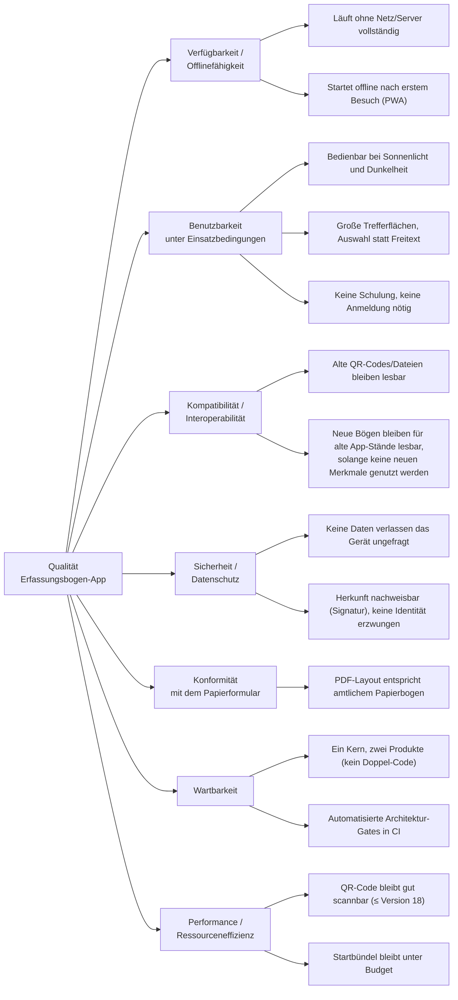

### 10.2 Qualitätsszenarien

| # | Qualitätsziel | Szenario | Bewertungsmaßstab / Nachweis im Repository |
| --- | --- | --- | --- |
| 1 | Offlinefähigkeit | Eine Einheit ruft die Web-App einmal online auf, verliert danach die Netzverbindung im Einsatzgebiet und füllt einen Bogen komplett aus, druckt PDF und erzeugt QR-Code. | Service Worker precacht App-Shell inkl. wasm/woff2 (`vite.config.ts`, VitePWA), Übungsbögen und Themenseiten als zweite Stufe danach (6.4); Szenario „Die PDF entsteht auch ohne Netz und ohne Neuladen" in `features/uebergabe.feature`. |
| 2 | Benutzbarkeit im Feld | Ein Nutzer schaltet bei grellem Sonnenlicht in den Feld-Modus und kann alle Bedienelemente weiterhin klar erkennen. | `anzeige-modus.ts`, `features/daten-und-anzeige.feature` (Anzeigemodus Dunkel/Feld/Nacht, auch bei dunklem Systemdesign). |
| 3 | Schnellerfassung | Eine fremde Einheit trifft ohne eigenen Bogen ein; sie wird in wenigen Minuten erfasst (nur Stärke, Führungskraft, Fahrzeuge), der Bogen gedruckt oder an die Meldekopf-App gegeben. | `personalErfassung = NUR_STAERKE`, Minimalfelder laut `docs/datenmodell.md` („Meldekopf-Workflow"), gemessene Payload-Größe 191 Bytes → QR-Version 10. |
| 4 | Rückwärtskompatibilität | Ein vor Jahren gedruckter QR-Code (Schema-Version 2) wird mit der aktuellen App-Version gescannt und korrekt angezeigt. | Eingefrorene v2-Fixture in `codec.migration.test.ts` und `features/fixtures.ts`; `migriereBogen` deckt `2..SCHEMA_VERSION` ab. |
| 5 | Vorwärtskompatibilität | Ein mit der neuesten App erzeugter, aber „einfacher" Bogen (keine Übung, eine Fahrerlaubnisklasse je Person) wird von einer älteren App-Version noch gelesen. | `transportSchemaVersion()` wählt die kleinste tragende Schema-Version statt stets `SCHEMA_VERSION`. |
| 6 | Datenschutz | Ein Bogen wird offline per QR-Code weitergegeben; zu keinem Zeitpunkt wird ein Server kontaktiert oder ein Tracking-Cookie gesetzt. | CSP erlaubt nur `erfassungsbogen.goatcounter.com` als externen Host, keine Cookies (`vite.config.ts`); `PRODUCT.md` „Alles bleibt auf dem Gerät". |
| 7 | Herkunftsnachweis ohne PKI | Ein Meldekopf empfängt einen weitergereichten Bogen mit zwei Signaturstufen (Ersteller, Meldekopf) und sieht den vollständigen Meldeweg. | Signaturkette/Gegenzeichnen in `docs/datenmodell.md`; Anzeige „Meldeweg: Ursprung → Zwischenstelle → Absender". |
| 8 | Konformität mit Papierformat | Das gedruckte PDF eines THW-Bogens entspricht optisch dem amtlichen Papierbogen und lässt sich in bestehende (nicht-digitale) Meldewege einreihen. | `PRODUCT.md` Prinzip 3 „Das Papier ist der Vertrag"; `pdf-dokument.ts` im nachgemessenen Raster der Word-Vorlage (`RASTER`, `BOGEN_RAENDER`), `pdf-seiten.test.ts`. |
| 9 | Wartbarkeit über zwei Produkte | Eine Fehlerkorrektur im Codec wird im Kern-Repository committet und wirkt nach Aktualisierung des Submodul-Commits in beiden Produkten, ohne Codeduplikation. | Submodul-Architektur (`docs/entwicklung.md`), `npm run kern-kopien`-Gate verhindert Doppelkopien. |
| 10 | Bundle-Effizienz | Ein neuer Import eines großen Vokabular-Sammel-Moduls (statt modulgenau) wird im CI durch das Bundle-Budget erkannt und die Pipeline schlägt fehl. | `npm run bundle-budget` gegen `scripts/bundle-budget.json`, Gate in `ci.yml`. |
| 11 | QR-Scanbarkeit | Ein vollständig ausgefüllter THW-Bogen erzeugt einen QR-Code, der aus normaler Entfernung mit einer Handykamera in einem Zug scannbar ist. | Zielbudget ≤ QR-Version 18 (Fehlerkorrektur M); gemessen 511 Bytes → Version 18 unsigniert (`docs/datenmodell.md`). |
| 12 | Kein Datenverlust bei Fehlbedienung | Ein Nutzer löscht versehentlich eine Vorlage und holt sie aus dem Papierkorb zurück; er öffnet einen fremden Bogen über den eigenen und findet den eigenen auf dem Rückholplatz; er entfernt eine Person und nimmt es mit „Rückgängig" zurück. | Prinzip „Nichts geht verloren" (`PRODUCT.md`); `vorlagen.ts`, `entwurf.ts`, `rueckweg-sitzung.ts`; `features/vorlagen.feature`. |
| 13 | Übergabe an den Meldekopf | Eine Einheit gibt ihren Bogen an die Meldekopf-App, die auf demselben oder einem anderen Gerät sammelt, ohne dass diese App eine Netzverbindung dorthin aufbaut. | QR-Code, Link, Datei; `meldekopfLink()` trägt den Bogen im URL-Fragment (`meldekopf-app.ts`, `meldekopf-app.test.ts`). |

### 10.3 Nicht formal festgelegte Qualitätsziele

Laut `PRODUCT.md` explizit noch nicht als bindende Zusage erklärt (Stand im
Dokument: 2026-08-06), obwohl faktisch etabliert und „bis auf Widerruf zu
bewahren": der Produktname „Erfassungsbogen"/erfassungsbogen.app, die
Amtlich-Optik über eigene Design-Token, die Schrift Archivo, die eingebackenen
taktischen Zeichen sowie der reine Schalter-Dunkelmodus. Ebenso ist kein
verbindlicher Barrierefreiheits-Standard (BITV/WCAG) festgelegt – nur
produktspezifisch umgesetzte Einzelmaßnahmen (Kontrast, Nacht-Modus).

---

## 11. Risiken und technische Schulden

Grundlage sind `docs/TODO.md`, die stillgelegten Teile der Release-Pipeline sowie
Beobachtungen aus der Code-/Teststruktur. Einschätzungen zu
Eintrittswahrscheinlichkeit/Auswirkung sind Interpretation, keine offiziellen
Angaben des Projekts.

### 11.1 Offene Risiken (aus `docs/TODO.md`)

| Risiko | Beschreibung | Mögliche Auswirkung |
| --- | --- | --- |
| macOS-Distribution ausgesetzt | Der `build-mac`-Job ist per `if: false` deaktiviert, weil die Code-Signatur auf dem GitHub-Runner mit „security set-key-partition-list … process failed 1" scheitert. | macOS-Nutzer haben keinen Desktop-Download, nur den Verweis auf die Web-App; ein wachsender Rückstand bei macOS-spezifischen Problemen ist möglich. |
| iOS-App noch nicht veröffentlicht | Kein App-Store-Eintrag, TestFlight „in Vorbereitung"; Geräte-/TestFlight-Tests sind offene To-dos. | iOS-Nutzer sind auf die Web-App angewiesen; native Fähigkeiten sind auf iOS ungetestet in Produktion. |
| Live-Kameratest ausstehend (Web/Electron) | Der Decodier-Roundtrip ist verifiziert (`npm run demo`), ein Live-Scan mit echter Kamera laut `docs/TODO.md` noch nicht. | Restrisiko, dass reale Kamerabedingungen (Beleuchtung, Fokus, Treiber) im Feld anders funktionieren als im Test. |
| Electron-Kamerazugriff (macOS, signiert) | `getUserMedia` benötigt im gehärteten, signierten Build `NSCameraUsageDescription` und das Hardened-Runtime-Entitlement für die Kamera; laut TODO noch zu verifizieren. | Ohne diese Einträge scheitert der QR-Scan in der signierten macOS-Desktop-App lautlos. |
| Android-Play-Signing-Wechsel | Wechselt das Projekt auf Google Play App Signing, signiert Google mit einem eigenen Schlüssel; der SHA-256-Fingerabdruck in `assetlinks.json` müsste ergänzt werden. | Ohne diesen Schritt bricht die Digital-Asset-Links-Verifikation und Deep Links gelten auf Android nicht mehr als „verified". |
| AASA-Content-Type über GitHub Pages | GitHub Pages liefert `apple-app-site-association` als `application/octet-stream` statt `application/json`; funktioniert nur, weil Apples CDN das akzeptiert (verifiziert 2026-07-12). | Ändert Apple diese Toleranz, brechen Universal Links ohne Codeänderung im Projekt. |
| Verzögerte Verifikation von Deep Links | Apple cached die AASA über sein CDN; nach einem Deploy kann die Verifikation bis zu 24 Stunden dauern. | Erschwert schnelles Debugging von Universal-Link-Problemen nach einem Release. |

### 11.2 Architektur- und Prozessrisiken

| Risiko | Beschreibung | Mögliche Auswirkung |
| --- | --- | --- |
| Externe Abhängigkeit von vier eigenständigen Kern-Repositories | Die vier `@bos/*`-Bausteine liegen in separaten GitHub-Repositories, als Submodule auf feste Commits gepinnt (ADR-003, Regel 6). | Ein Sicherheits- oder Korrektheits-Fix im Kern erreicht dieses Produkt erst, wenn jemand den Submodul-Commit bewusst aktualisiert; ohne festen Prozess können Fixes „liegen bleiben". Mitigiert durch die dokumentierte Exit-Strategie. |
| Koordinationsaufwand durch geteilten Kern | Änderungen am Kern betreffen S1-Control mit; sechs „Aufnahmeregeln" regeln, was in den Kern darf. | Ein für S1-Control sinnvoller Schnitt kann für den Erfassungsbogen suboptimal sein; Regel 1 kann Weiterentwicklung verzögern, bis der zweite Bedarf feststeht. |
| Peer-Dependency-„Diamant" bei `@bos/eeb-format` | `@bos/meldekopf` und `@bos/vokabulare` binden `@bos/eeb-format` als `peerDependency` ein – das konsumierende Produkt muss die eine gültige Kopie liefern. | Falsche Einbindung erzeugt zwei TypeScript-Typen gleichen Namens mit einer Fehlermeldung, „deren Ursache in keinem Stapelabzug steht" – ein bekanntes Stolperrisiko für neue Mitentwickler. |
| Kein `prepare`-Skript, manuelle Build-Reihenfolge | Die vier Kern-Pakete bauen ihr `dist/` nicht automatisch beim `npm install`. | Der Erfassungsbogen selbst ist unbetroffen (Vite bündelt die Quelle), aber S1-Control oder ein neuer Mitentwickler kann bei falscher Reihenfolge auf denselben CI-Fehler laufen (TS2307, 34 Folgefehler). |
| Übergangslösung bei den TypeScript-Werkzeugen der Kern-Submodule | Alle vier Kern-Pakete bauen/prüfen mit TypeScript 7 (`@typescript/native`), installieren aber zusätzlich `typescript-eslint` gegen eine TypeScript-6-Kompatibilitätsschicht. | Ausdrücklich als Übergang markiert; bis dahin ein zusätzlicher, undurchsichtiger Abhängigkeitspfad in allen vier Submodulen. |
| `@bos/vokabulare/berufe.ts` ohne regelmäßige Aktualisierung | Die 3512 Berufsbezeichnungen liegen als statische Tabelle im Submodul. Ein Generator (`npm run vokabular:berufe`, Abzüge der Bundesagentur für Arbeit unter `scripts/quellen/`) liegt in diesem Repository, läuft aber nur von Hand – anders als bei den taktischen Zeichen gibt es keinen Update-Workflow. | Die Liste kann veralten, ohne dass ein technischer Mechanismus das bemerkt. |
| Lizenzhistorie der taktischen Zeichen | Die Zeichen stammen aus einer externen Sammlung (CC BY 4.0, © Jonas Köritz); das Upstream-Projekt merkt an, dass die Lizenz vor Februar 2021 anders war. | Bei Verwendung sehr alter, zwischengespeicherter Zeichenversionen bestünde ein Restrisiko unklarer Lizenzbedingungen. |
| Sehr große Einzeldateien | `app.tsx` (2942 Zeilen), `schritte/personal.tsx` (2377), `pdf-dokument.ts` (2351) sowie `codec.ts` (1089) und `einsaetze.ts` (854) in den Submodulen. | Höheres Risiko von Merge-Konflikten und höherer kognitiver Aufwand; kein Hinweis, dass weitere Modularisierung geplant ist. |
| Bus-Faktor / Ein-Personen-Projekt | Alle fünf Repositories nennen denselben einzelnen Autor/Maintainer; keine sichtbaren CODEOWNERS oder weiteren Committer-Hinweise. | Wartung, Sicherheitsreaktion und Weiterentwicklung hängen an einer Person – verschärft dadurch, dass auch S1-Control vom selben Kern abhängt. |
| TOFU-Vertrauensmodell ohne PKI | Bewusster Verzicht auf zentrale Zertifizierung bei den Ed25519-Signaturen. | Ein Schlüssel-Fingerabdruck bestätigt nur „derselbe Absender wie zuvor", nicht die reale Identität; Social-Engineering-Angriffe sind architektonisch nicht ausgeschlossen. |
| Native Gerätetests fehlen | Kamera-Scanner, Filesystem-Zugriff und Share-Sheet sind laut `docs/tests.md` „Ausbaustufe 3". | Regressionen in den plattformspezifischsten Pfaden werden nicht automatisch erkannt. |
| Offene Punkte im Datenmodell (Stufe 2) | `docs/datenmodell.md` nennt u. a. einen noch festzulegenden Aktualisierungsweg für das eingebettete THW-Ortsverbandsverzeichnis und ein noch nicht umgesetztes Deflate-Preset-Dictionary (zusätzliche 10–20 % Kompression). | Ohne Aktualisierungsweg veralten die eingebetteten Referenzdaten mit der Zeit. |
| `style-src` mit `'unsafe-inline'` | `script-src` gibt die Inline-Blöcke einzeln per `sha256`-Hash frei und kommt ohne `'unsafe-inline'` aus; `style-src` braucht es, weil React `style`-Attribute setzt. | Ein eingeschleustes Skript fängt die CSP ab. Style-Injection bleibt möglich: in dieser App kein Datenabfluss, aber eine Darstellungsmanipulation. |
| Drei Apps und eine Portierung lesen dasselbe Format | Meldekopf-App, S1-Control und der VBA-Leser müssen jede Schemaänderung mitgehen (Kapitel 2.2); die Regel steht in `CLAUDE.md`, technisch erzwungen ist nur der Schema-Stand der Portierung in der CI des Format-Repos. | Bleibt ein Leser zurück, lehnt er neue Bögen ab oder zeigt sie falsch an, und zwar am Meldekopf, wo der Bogen gebraucht wird. |
| Neue Bögen fordern Schema 11 | Die vorbelegte Uhrzeit zum Zeitraum hebt jeden neuen Bogen mit Zeitraum auf Schema 11 (Kapitel 8.4). | Die Vorwärtskompatibilität über die kleinste tragende Version greift für solche Bögen nicht: Geräte mit einem App-Stand vor Schema 11 lesen sie nicht. |
| Altbestand an Einsatz-Sammlungen auf Geräten | Sammlungen aus der Zeit vor der Meldekopf-App liegen weiter unter `eeb.einsaetze.v1`, bis jemand sie sichert oder löscht; die App zeigt nur ihre Zahl. | Personendaten bleiben auf dem Gerät, ohne dass sie jemand sieht. Begrenzt durch die Fristen des Kerns (Datenschutzfrist je Meldung, Aufräumfrist ruhender Sammlungen), die über `einsaetze-lesen.ts` weiter greifen. |
| Übungsbögen aus Momentaufnahmen fremder Seiten | Die Bögen der THW-Ortsverbände und der Wachen Niedersachsens beruhen auf Abzügen von thw.blafusel.de und bos-fahrzeuge.info (`scripts/quellen/`). | Die Daten veralten und sind lückenhaft (zwölf Landkreise fehlen); ein Aktualisierungslauf hängt an der Erreichbarkeit und dem Aufbau fremder Seiten. Die App selbst ruft dort nichts ab. |

### 11.3 Technische Schulden (explizit im Code/Docs vermerkt)

- **Release-Aufräumung behält nur 10 Releases** (`KEEP: 10` in `release.yml`) –
  ältere Installer sind über GitHub Releases nicht mehr greifbar.
- **`docs/TODO.md`** führt mehrere unerledigte Punkte als Checkliste (Gerätetest
  iPhone, App-Store-Connect-Einrichtung, Live-Webcam-Test,
  Electron-Kamera-Entitlements, Play-Signing-Fingerabdruck-Nachtrag).
- **Vokabular-Tabellen** laut `docs/datenmodell.md`, Abschnitt „Offene Punkte für
  Stufe 2", noch auszuarbeiten – die Basisarchitektur steht, die inhaltliche
  Vollständigkeit je Organisation ist fortlaufender Pflegeaufwand.
- **Zwei TypeScript-Versionen nebeneinander** in allen vier Kern-Submodulen –
  Übergangslösung mit definiertem Wegfallkriterium.
- **Reste der Einsatz-Sammlung im Code** (Kapitel 5.2): Module ohne Aufrufer in
  der Oberfläche (`einsatz-abgleich.ts`, `export-stand.ts`, `fassung-vorrang.ts`,
  große Teile von `eintrag-zeiten.ts`, `lagemonitor-beginn.ts`,
  `lagemonitor-speicher.ts`, die Stilvorlage `lagemonitor.css`), die Marke
  `Entwurf.fremd` (Erfassung für eine Sammlung) in `entwurf.ts` und `app.tsx`
  sowie die Ausnahme für Fenster mit `?lagemonitor=` in `electron/main.js`. Sie
  stören nicht, vergrößern aber Lese- und Pflegeaufwand; allgemeine Helfer wie
  `speicherBelegung` liegen dadurch in einem Modul, dessen Name anderes
  verspricht.
- **„Zeitraum nicht angegeben" außerhalb der App:** Die Konvention Tag 0 an
  beiden Enden kennen nur App, PDF und CSV; die Portierungen unter
  `vendor/eeb-format/ports/` und der Meldungsvergleich in `@bos/meldekopf`
  zeigen „01.01.2020" und sind nachzuziehen.
- **Unvollständige Übungsbögen Niedersachsen:** Zwölf der 45 Landkreise und
  kreisfreien Städte fehlen bei den realen Wachen, weil der Abruf der Quelle am
  Zeitlimit abbrach.
- **`packages/kern-vendor/`-Rückweg ist vorbereitet, aber ungenutzt** – die
  Exit-Strategie ist eine Prozessvereinbarung, kein eingerichteter Mechanismus.

---

## 12. Glossar

### Fachbegriffe (BOS/Einsatzwesen)

| Begriff | Bedeutung |
| --- | --- |
| BOS | Behörden und Organisationen mit Sicherheitsaufgaben (THW, Feuerwehr, Polizei, Rettungsdienst, Hilfsorganisationen, Bundeswehr, Katastrophenschutz). |
| THW | Technisches Hilfswerk. |
| DRK / JUH / MHD / ASB | Deutsches Rotes Kreuz / Johanniter-Unfall-Hilfe / Malteser Hilfsdienst / Arbeiter-Samariter-Bund – Hilfsorganisationen. |
| DLRG | Deutsche Lebens-Rettungs-Gesellschaft. |
| Erfassungsbogen | Das (ursprünglich papierene) Formular, mit dem eine Einheit Stärke, Personal, Fahrzeuge und Sofortbedarf für einen Einsatz oder eine Übung dokumentiert. |
| Übungsbogen | Mitgelieferter, ausgefüllter Bogen einer fiktiven Einheit mit erfundenen Personen, zum Üben am Meldekopf und zum Ausprobieren der App (Dialog „Übungsbögen“). Alle sind als Übung gekennzeichnet; dieselbe Kennzeichnung kann jeder eigene Bogen in Schritt 2 tragen. Dieselben Dateien speisen die Landesvorlagen in Schritt 1. |
| Einheit | Die organisatorische Grundeinheit, die einen Erfassungsbogen führt (z. B. eine Fachgruppe, ein Löschzug, eine SEG). |
| Einsatz | Der konkrete Einsatz- bzw. Übungskontext (Zeitraum, Ort, Auftrag), unter dem Einheiten gemeldet werden. |
| Übung | Kennzeichnung eines Bogens als Übungs- statt echten Einsatzbogen (ab Schema-Version 6); wird in PDF/Anzeige deutlich markiert. |
| Meldekopf | Sammelstelle, die eintreffende (fremde) Einheiten erfasst bzw. deren Bögen aufnimmt und Stärke/Bedarf für die nächste Führungsstelle zusammenfasst. Das Werkzeug dafür ist die Meldekopf-App. |
| Einzelperson | Einzeln anrückende Person (Fachberater/in u. a.), die statt einer Einheit gemeldet wird; im Modell `einheit.einzelperson`. |
| Bereitstellungsraum | Ort, an dem Einheiten vor ihrem Einsatz gesammelt und für die Zuweisung vorgehalten werden. |
| Führungsstelle | Übergeordnete Leitungsebene, die Meldungen mehrerer Meldeköpfe/Einheiten empfängt und weiterverarbeitet. |
| Stärke | Personalstärkeangabe einer Einheit in der Schreibweise `x/y/z//g` (Führer/Unterführer/Mannschaft//Gesamt), in Oberfläche und PDF als `F / U / M // G` gesetzt. |
| Sofortbedarf | Unmittelbarer Bedarf einer eintreffenden Einheit: Verpflegung, Betriebsstoff, Unterbringung, Ruhezeit. |
| StAN | Stärke- und Ausstattungsnachweisung – die organisationsseitig festgelegte Soll-Ausstattung einer Einheit. |
| Funkrufname | Standardisierte Sprechfunkbezeichnung eines Fahrzeugs/einer Einheit (z. B. „Heros Oldenburg 18/13"); als Erreichbarkeit einer Person die vierte Kontaktart neben Mobil, Festnetz und E-Mail (`KontaktArt.FUNK`, Anzeige `Funk: …` ohne dienstlich/privat). Sitzen mehrere Ortsverbände in einer Stadt, greift die Großstadtregelung: alle sprechen auf den Stadtnamen, der OV steht als führende Kennzahl davor („Heros Berlin 06/22/51"). |
| Taktisches Zeichen | Genormtes grafisches Symbol zur Kennzeichnung von Einheiten/Fahrzeugen/Einrichtungen im BOS-Umfeld. |
| Zeichenfarbe | Abweichende Grundfarbe des taktischen Zeichens eines Fahrzeugs (`Fahrzeug.zeichenfarbe`: kommunal, grau) für Gerät von Partnern, das eine Einheit führt; Auswahl „Farbe des Zeichens" in Schritt 4. |
| Dienststelle (je Person) | Optional die Abweichung von der Dienststelle der Einheit (`Person.dienststelle`), etwa ein Helfer aus dem Nachbar-Ortsverband; im PDF „OV: …" hinter dem Namen. |
| Fachgruppe | THW-spezifische Bezeichnung einer spezialisierten Teileinheit (z. B. „FGr K (A)" – Fachgruppe Küche). |
| Ortsverband (OV) | Regionale Gliederungsebene, insbesondere beim THW; im Datenmodell über `standortRef` referenzierbar. |
| Kennzeichen | Amtliches oder organisationsinternes Fahrzeugkennzeichen (z. B. „THW-84397", „OL-FW 2041"). |

### Technische Begriffe (dieses Projekt)

| Begriff | Bedeutung |
| --- | --- |
| `EEB2` / `EEB2C` | Magic-Bytes/Format-Kennung des QR-Payloads: `EEB2` = unsignierter Bogen, `EEB2C` = signierter Container mit einer oder mehreren Signaturstufen. |
| Base41 | Eigenes, an Base45/RFC 9285 angelehntes, aber URL-sicheres 41-Zeichen-Alphabet zur Transportkodierung des QR-Dateninhalts (alphanumerischer QR-Modus). |
| THW-Word-Bogen | Ausgefüllter Erfassungsbogen aus einer THW-Word-Vorlage `06-*_Erfassungsbogen.dotx`, gespeichert als `.docx`; die App liest seine Formularfelder (`word-bogen.ts`, `docs/thw-word-vorlagen.md`). |
| THWin-Raster | Das an der Word-Vorlage `06-K_A_Erfassungsbogen.dotx` nachgemessene Seitenraster, in dem `pdf-dokument.ts` den Bogen setzt. |
| Meldekopf-App | Eigenes Produkt (`wattnpapa/meldekopf`, `meldekopf.erfassungsbogen.app`), das die Einsatz-Sammlung führt: Bögen mehrerer Einheiten sammeln, summieren, Lageblatt, Sammel-PDF, Lagemonitor. |
| Altbestand | Einsatz-Sammlungen, die aus der Zeit vor der Meldekopf-App noch unter `eeb.einsaetze.v1` auf einem Gerät liegen. |
| Personalstamm | Auf dem Gerät gehaltene Helferliste einer Dienststelle (`eeb.personalstamm.v1`), aus CSV oder Excel eingelesen; Quelle für „Wer ist dabei?". |
| Rückholplatz | Der eine Platz (`eeb.entwurf.ersetzt.v1`), auf dem ein verdrängter Bogen wartet. |
| Datenschutzfrist | 90 Tage nach dem Stand eines Bogens werden seine Personaldaten anonymisiert; Übungen und Vorlagen ausgenommen. |
| Offline-Vorrat | Was der Service Worker vorhält: Kern (Precache), Zusatzstufe (`eeb-zusatz`) und Dateien „nur auf Abruf" (`eeb-ov-beispiele`). |
| Portierung | Handgepflegter Leser des EEB-Formats in einer anderen Sprache unter `vendor/eeb-format/ports/`, derzeit VBA für Excel. |
| Änderungsverlauf („Was ist neu") | Von Hand gepflegte Liste sichtbarer Änderungen in `src/app/aenderungen.ts`, erreichbar über die Versionsnummer in der Fußzeile. |
| Schema-Version | Versionsnummer des Datenmodells (aktuell 13); steuert, welche Felder ein Bogen enthalten kann und wie er migriert wird. |
| `transportSchemaVersion` | Funktion, die beim Kodieren die kleinste Schema-Version wählt, die den tatsächlichen Bogeninhalt noch verlustfrei trägt. |
| Segmentierung (`EEBS.`) | Aufteilung eines zu großen Bogens auf mehrere QR-Codes; jeder Teil trägt Teilnummer, Gesamtzahl und eine Prüfsumme. |
| Absenderkarte | Freiwillig hinterlegte Kontaktangabe (Name/E-Mail/Telefon) eines Geräts, die signiert mit jedem übergebenen Bogen mitreist. |
| Signaturkette / Gegenzeichnen | Mechanismus, bei dem ein unverändert weitergereichter Bogen um eine zusätzliche Signaturstufe ergänzt wird, statt neu signiert zu werden. |
| TOFU | Trust-On-First-Use – Vertrauensmodell ohne zentrale Zertifizierungsstelle. |
| Vokabular-Wert (`VokabularWert`) | Datentyp, der einen kontrollierten Wert entweder als 1-Byte-Code im Organisations-Namensraum oder als Freitext-Ausweg (`code 0` + String) trägt. |
| Namensraum (Organisationstyp) | 1-Byte-Enum, das festlegt, in welcher organisationsspezifischen Vokabular-Tabelle Codes aufgelöst werden. |
| `personalErfassung` | Enum `VOLLSTAENDIG` (jede Person einzeln erfasst) vs. `NUR_STAERKE` (Schnellerfassung). |
| ADR | Architecture Decision Record – dokumentierte Architekturentscheidung. |
| S1-Control | Schwesterprodukt, das denselben UI-freien Kern nutzt und Erfassungsbögen einliest. |
| Kern-Kopien-Prüfung (`kern-kopien`) | CI-Prüfschritt, der sicherstellt, dass jeder der vier Kern-Bausteine genau einmal im Abhängigkeitsbaum vorkommt. |
| Bundle-Budget | CI-Prüfschritt, der die Größe des gebauten Web-Bundles gegen `scripts/bundle-budget.json` prüft. |
| PWA | Progressive Web App – die unter erfassungsbogen.app gehostete, offlinefähige Web-App mit Service Worker. |
| Capacitor | Framework, das eine Web-App in eine native Android-/iOS-App-Hülle einbettet. |
| Electron | Framework, das eine Web-App als Desktop-Anwendung ausliefert. |
| Workbox / vite-plugin-pwa | Bibliothek bzw. Vite-Plugin zur Erzeugung des Service Workers samt Precache-Konfiguration. |
| GoatCounter | Cookielose, datensparsame Web-Analytics-Lösung, der einzige in der CSP erlaubte externe Host. |
